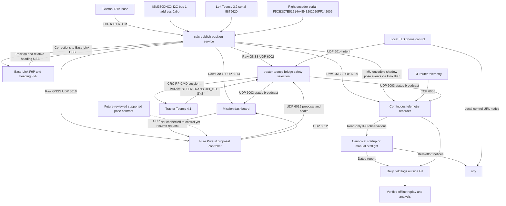

# Codex Context — Tractor Robot Project

## Working Directory
Use the permanent checkout for the machine running Codex:

- Windows: `C:\Repos\tractor2025`
- RPi5NAS: `/home/al/repos/tractor2025`
- Tractor01 runtime checkout: `/home/al/tractor2025`

Do not confuse a Codex worktree, temporary cleanup clone, or historical
`tractor2025-rpi-lease` path with the production checkout. GitHub `main` is the
source of truth. Tractor01 pulls from GitHub; it is not the development master.

For any live Tractor01 field work, read
`field_testing/TRACTOR01_CURRENT_FIELD_CONTEXT.md` before suggesting commands.
That file contains the current production paths, service owners, dashboard
semantics, preflight command, and operator-confirmed live-system automation.

## Who I Am
Al — hobbyist robotics developer. Not a professional software engineer.
Walk me through processes step by step when needed.

## The Robot Project
Autonomous outdoor robot on a **Cub Cadet XT1 LT42 EFI** riding mower chassis.
Full documentation: `obsidian_vault/00-project-overview.md`

### Hardware Summary
| Component | Details |
|-----------|---------|
| Low-level controller | Teensy 4.1 — steering PID, transmission, RPi command lease, e-stop relay |
| Primary compute | Raspberry Pi 5 — navigation, GPS, teleoperation |
| Steering | IBT-2 H-bridge, PID (kp=1.0, ki=0.0, kd=0.0), pot feedback A9 |
| Transmission | Pololu JRK G2 21v3 linear actuator, 10-bucket system, commissioned neutral=2836 |
| GPS | 2× ArduSimple ZED-F9P RTK moving-base pair; JSON published at 20 Hz and RELPOSNED heading at approximately 5 Hz |
| Retired hardware | NRF24 is no longer physically used on Tractor01; do not add it to the production build |
| Camera | OAK-D stereo (WebRTC teleoperation) — DepthAI must stay at 2.30.0.0 |
| LED tower | PCA9685 via I2C, channels 8–12 |

### Robot RPi Connection (onboard the tractor)
- Hostname: `raspberrypi` | User: `al`
- Production field Ethernet: `192.168.8.20/24`, GL router gateway `192.168.8.1`
- ZeroTier IP: `192.168.193.76`
- Serial bridge: `460800 baud` USB (`/dev/teensy`)
- Reachable from the dev NAS over ZeroTier (`192.168.193.x` network).

### RPi Command Modes
| Mode | Value | Behavior |
|------|-------|----------|
| Pause | 0 | Transmission neutral, steering hold |
| Manual | 1 | Signed drive percent and normalized steering from the RPi arbitrator |
| Auto | 2 | Calibrated m/s and normalized steering from the RPi arbitrator |
| E-stop | 3 | Latches the Teensy software e-stop relay output |
| Reset Pause | 4 | Clears the software e-stop only as a zero Pause command |

### UDP ports and duplicate feeds

Ports **6002, 6009, 6010 and 6013 deliberately receive the same raw GNSS JSON
snapshot at approximately 20 Hz**. Each unicast consumer has its own socket/port;
sharing a unicast receive socket would make consumers contend for packets rather
than reliably give every consumer a copy. The recorder captures ONE GNSS feed,
not four duplicate recordings. These ports still carry raw GNSS, not the
experimental IMU/encoder pose. Native heading updates are approximately 5 Hz;
a repeated 20 Hz snapshot is not a new independent heading measurement.

| Port | Content |
|------|---------|
| 6002 | Dedicated 20 Hz raw GNSS copy for the Teensy bridge/safety selection |
| 6003 | Combined Teensy, command-lease, and RPi-arbitrator status broadcast |
| 6004 | Legacy `cmd_vel` input; production arbitrator rejects/bypasses it as a motion authority |
| 6009 | Dedicated 20 Hz raw GNSS feed; sole current owner is the continuous telemetry recorder |
| 6010 | Dedicated 20 Hz raw GNSS feed for Pure Pursuit; fused pose has NOT replaced it |
| 6011 | Mission-dashboard Pause/resume control |
| 6012 | Pure Pursuit dashboard telemetry |
| 6013 | Dedicated 20 Hz raw GNSS copy for the mission dashboard |
| 6014 | Authenticated phone intent to the RPi safety arbitrator |
| 6015 | Pure Pursuit proposal and health feed to the RPi safety arbitrator |

### Current Firmware
| Board | File |
|-------|------|
| Tractor Teensy 4.1 (commissioned on hardware) | [`tractor_teensy/src/teensy_main_20261110.cpp`](tractor_teensy/src/teensy_main_20261110.cpp), firmware identity `teensy_main_20261110_rpi_command_lease_v5` |
| Canonical build configuration | [`tractor_teensy/platformio.ini`](tractor_teensy/platformio.ini); it selects only the consolidated production source |
| Retired NRF handheld | Historical source remains under `radiocontrol_nrf24radio/`, but the radio is not physically used and has no production command authority |

The commissioned v5 firmware was compiled and uploaded from GitHub `main`
commit `755bde9` on 2026-11-11. It implements steering PID and response watchdog,
JRK transmission control and diagnostics, 500 ms RPi command lease, session and
sequence validation, Pause/Manual/Auto/software-E-stop/guarded-reset modes, and
telemetry including JRK VIN millivolts. Commissioned steering values are right
`191`, center `525`, and left `885`; JRK neutral is `2836`.

### Active development focus — November 19, 2026

- Consolidated producer, bridge and continuous recorder were installed November 18
  and exercised in a November 19 manual run. Canonical preflight is now
  `python3 -m tractor_rpi.tractor_preflight`; see the startup section below.
  This is evidence of manual acquisition, not unattended boot reliability or
  validation of a fused navigation pose.
- Analyze the verified November 17 and November 19 runs: wheel signs/scales,
  IMU heading prediction, source timing, GNSS health, and hard-turn geometry.
- Prepare a supported pose contract for Pure Pursuit while keeping estimation
  separate from motion authorization. The current pose remains shadow-only and
  `valid_for_control=False`; all four GNSS ports retain their raw schema.
- Proposed GNSS-degraded travel limit is 3 m or 30 s, whichever occurs first,
  at at most 0.3 m/s, subject to review. At 0.3 m/s, 3 m is 10 s, not 30 s.
  Do not implement that proposal by extending local freshness/watchdog limits.
- JRK VIN is now captured with raw status by the continuous recorder. The older
  independent battery logger remains uninstalled; it is not an additional source.
- IBT-2 Gen2 wiring remains planned but not implemented.

### Known Issues
1. Voltage alone cannot distinguish the engine alternator from an external battery charger.
2. All grounds must be tied — previous Teensy damage from 328Ω between Teensy and JRK G2 grounds
3. DepthAI must stay at version `2.30.0.0` (3.0 is incompatible)
4. IBT-2 overcurrent latch — reset by pulling motor fuse 5 sec; R_EN/L_EN hardwired to 5V currently
5. Pixel hotspot MAC randomization can cause WiFi failures — clear `802-11-wireless.bssid` if needed.
6. Left encoder Teensy 3.2 USB serial `5879620` repeatedly enumerates after a cold
   Pi boot but sends no serial rows. Rebinding cdc_acm did not help; targeted USB
   deauthorization/reauthorization restored output without reflashing or resetting
   its running device clock. Root cause remains unisolated; no automatic recovery
   is installed. Firmware loss is not established. Never hardcode ttyACM numbers.
7. GNSS Float persisted despite fresh corrections and about 31 used satellites.
   Recovery followed service/base restarts in different trials; no isolated root
   cause is established. A November 19 move to less perceived multipath coincided
   with healthy GNSS, but does not prove causation. Do not diagnose by satellite
   count alone or repeatedly restart healthy services.
8. Pi power/CPU logger source was located November 19 at `/usr/local/bin/pilog.sh`.
   Original capture and installed daily-storage source are under
   `tractor_rpi/setup/pilog/`. Installed November 19; output is now under `/home/al/field_logs/YYYY-MM-DD/`. This script sends a boot ntfy only; the
   reported repeated runtime alerts remain untraced.

---

## Current Tractor01 Production Software

Treat this as the current key-program inventory. Confirm installed unit contents
against these repository files before changing services because the RPi may not
yet have pulled the newest `main` commit.

### Boot services and persistent processes — installed November 18

| Service | Repository source | Role |
|---|---|---|
| `calc-publish-position.service` | `tractor_rpi/setup/calc-publish-position.service`; `tractor_rpi/calc_publish_position.py` | Owns both F9Ps, IMU and encoder acquisition; forwards external RTCM; publishes four unchanged raw GNSS copies and records experimental pose via IPC. Alias `rtcm-server.service` refers to this same unit. |
| `tractor-teensy-bridge.service` | `tractor_rpi/setup/tractor-teensy-bridge.service`; `tractor_rpi/teensy_serial_bridge_rpi_arbitrator_20261104.py` | Sole `/dev/teensy` owner at 460800 baud; unchanged bridge plus RPi safety-selection logic. Alias `tractor-rpi-arbitrator.service` is the same unit. |
| `tractor-phone-arbitrator.service` | Frozen November 4 package unit; `tractor_rpi/testing/webrtc/wifi_rpi_arbitrator_control_20261104.py` | Local authenticated TLS phone control, accepted-command logs, UDP 6014 intent and best-effort ntfy notices. Depends on bridge through its alias. |
| `tractor-telemetry-recorder.service` | `tractor_rpi/setup/tractor-telemetry-recorder.service`; `tractor_rpi/telemetry_recorder.py` | Independent continuous boot recorder; owns UDP 6009, listens to status 6003 and router TCP 6005, accepts sensor/event/pose IPC. |
| `tractor-startup-preflight.service` | `tractor_rpi/setup/tractor-startup-preflight-consolidated.service`; `tractor_rpi/tractor_preflight.py --startup` | One-shot readiness wait, full checks, dated local report and best-effort notices. Does not grant motion or automatically retry a completed failure. |
| `zerotier-one.service` | OS package | Maintenance, base access and evidence transfer; local router remains primary phone-control path. |
| `pilog.timer` / `pilog.service` | `/usr/local/bin/pilog.sh`; captured source and prepared replacement in `tractor_rpi/setup/pilog/` | Pi 5 V/throttling, load averages, ARM MHz and temperature CSV. Daily `/home/al/field_logs/YYYY-MM-DD/`; legacy logs archived and independently verified. |

The retired **`teensy-bridge.service` remains masked**. Do not confuse it with
`tractor-teensy-bridge.service`. Legacy `tractor-wifi-control.service`,
`tractor-wifi-direct-mission.service` and `tractor-wifi-recovery.service` stay
inactive. Exactly one process owns each serial device. Installed consolidation
backup: `/var/backups/tractor-consolidation-20261118T181841Z`.

### Program/module boundaries

- `calc_publish_position.py`: background readers for base GPS, heading GPS, IMU,
  left encoder, right encoder and RTCM forwarding; an additional readiness thread
  queries recorder windows every 0.5 s. IPC publishing has its own bounded worker.
  The scheduled 20 Hz main loop calls **`ingest_gps()`**, **`ingest_imu()`**,
  **`ingest_encoders()`**, `update_pose()`, `assess_pose_quality()`,
  `publish_navigation_if_due()` and `queue_diagnostics_if_due()`. Queue draining
  retains native samples and processes them by monotonic source time. RTCM byte
  forwarding is a separate function/thread so it does not block the pose loop.
- `position_gnss_protocol.py`: wire decoding; `imu_sensor.py`: sensor scaling/yaw
  helpers; `position_model.py`: explicit sensor quality/calibration and shadow pose.
- `telemetry_ipc.py`: bounded Unix socket, sequencing/ACK/deduplication and read-only
  query windows at `/run/tractor-telemetry/recorder.sock`. It is not a new UDP port.
- `telemetry_recorder.py`: capture/rotation/recent windows; `field_telemetry_schema.py`:
  compatible field-CSV mapping; `export_telemetry_run.py`: verify closed manifests
  and export explicit time windows. Preflight queries recorder data rather than
  taking UDP 6009 away from the recorder.
- Pi `get_wifi_info()` was intentionally omitted from the replacement producer.
  GL-router signal information is a separate recorder input on **TCP 6005**.
  External base corrections arrive on **TCP 6001**, not UDP.

### High-level system design



### Startup sequence, waits, Pause and notices

These are the implemented paths, not a promise that every boot is healthy.
Engine OFF, tractor stationary, blades disengaged and handheld in Pause are the
startup procedure. The IMU does not infer engine-off from voltage or vibration.

1. **OS/device/network readiness:** udev supplies GNSS and tractor serial aliases;
   encoder discovery matches USB serial IDs, never ttyACM numbers. Ethernet must
   have `192.168.8.20/24`, gateway `192.168.8.1`; ZeroTier supplies the base route.
   `network-online.target` ordering alone does not prove those paths usable.
2. **Recorder starts independently after local filesystems.** It creates its Unix
   socket and daily storage without waiting for RTK, calibration or full preflight.
   Daily directories are Eastern dates, raw UTC/monotonic timestamps are retained.
   Segment names contain UTC time; rotate about every 15 minutes and at day change.
   Channels: `gnss`, `status`, `imu`, `encoders`, `pose`, `router`, `events` JSONL,
   plus `field.csv`, `metadata.json` and closed-segment `SHA256SUMS`. Low space/write
   failures report failure; no automatic deletion of evidence. Restart-on-failure
   delay is 3 s; producer restart-on-failure delay is 5 s.
3. **Position startup hook:** after network/recorder ordering, the F9P configuration
   script `testing/configure_dual_f9p_5hz_profile_20260923.py --heading-startup
   --device-wait-seconds 30` waits for devices, writes the established moving-base
   Heading profile to volatile RAM, requires ACK and independent 22-value readback,
   then releases the serial device. Failure prevents producer startup. This hook
   runs at every successful producer service start, not just once per boot.
4. **Bridge and phone:** bridge starts after network ordering, claims the Teensy
   using Pause, and requires matching fresh acknowledgement before Manual/Auto.
   The phone service requires the bridge alias, readable TLS files and the local
   Ethernet address. It starts control in Pause. Stopping the bridge can stop the
   dependent phone service; restarting only the bridge may not restore the phone.
   Both have 2 s restart-on-failure delays. A phone request is not actual output;
   local safety selection and the independent 500 ms Teensy lease remain active.
5. **Local-control ntfy notice:** phone connectivity monitoring checks every 3 s;
   when a private local address is available it attempts `Tractor01 local control
   ready` with the local URL (including its existing authentication handling).
   Failed notification attempts are retried at 15 s intervals. This notice means
   the local-control path is advertised, NOT that GNSS/calibration/preflight passed.
   The installed `--local-control-ntfy-only` suppresses ZeroTier-ready/delayed/recovery
   notices; those exist in the inherited monitor but are not expected here.
6. **Raw acquisition and calibration:** producer reader threads begin immediately;
   raw IMU is retained even while waiting. First producer start of a boot assumes
   the operator followed engine-off startup. A `/run/tractor-position/calibration-started`
   token survives service restarts and clears on reboot. Later producer restarts
   need an explicit engine-off preflight confirmation to arm fresh calibration.
   The producer requires fresh actual Pause, zero steering PWM, JRK requested and
   actual targets 2836, healthy Fixed stationary position with speed <=0.05 m/s,
   and both fresh valid quiet encoder streams continuously for **3 s**. Stationary
   encoder noise allowance is 8 ticks per 100 ms, scaled by device interval; raw
   ticks are unchanged. Then **1 s settling + 10 s calibration**, at least 800
   samples with gyro/acceleration noise and magnitude checks. A calibration failure
   disarms it; no silent moving-engine recalibration. Bias calibration is separate
   from compass alignment. Healthy position AND heading permit experimental
   heading anchoring every **5 s**; gyro prediction runs between anchors. This
   affects shadow pose only, not the four raw GNSS feeds or motion authority.
7. **Startup preflight readiness wait:** systemd orders the one-shot after network,
   producer, bridge, phone and recorder start jobs; overall service timeout is
   **600 s**. `wait_for_readiness()` checks recorder health, services, Heading-hook
   proof and network paths, then latest pose/calibration, heading-anchor existence,
   and nonzero GNSS/status/IMU/encoder recording counts. It polls with **3 s pauses**
   for a default **300 s**. Counts are not proof both encoders are currently fresh;
   the subsequent full checks test them separately. Once service/network checks
   pass it sends one `Tractor01 startup sources settling` notice. Timeout logs the
   missing-readiness condition and STILL proceeds to full checks; it is not a PASS.
8. **Full preflight and notice:** startup sends `Tractor01 full preflight starting`
   after the readiness wait returns, even if it timed out. Full checks require
   devices, RTCM flow, a stable **5 s** GPS/heading window (default wait **60 s**),
   status/JRK/firmware/Pause and recorder/IMU/both-wheel health. Heading satellite
   gate: >25 PASS, 24–25 WARNING (currently non-failing), <=23 fail. Requested and actual
   JRK neutral are 2836. Each encoder needs >=5 distinct device clocks in 5 s,
   latest age <=0.5 s and valid producer state; zero movement is allowed. The
   dated report is `/home/al/field_logs/YYYY-MM-DD/preflight_<local time>.txt`.
   Startup sends `Tractor01 preflight PASS` or `Tractor01 preflight FAILED` with
   the report location. Each preflight notice has up to **3 attempts**, **5 s**
   HTTP timeout per attempt, and **2 s** between failed attempts. Notification
   calls can extend elapsed startup time; delivery is never a health/motion gate.
9. **After completion:** startup is a one-shot (`RemainAfterExit=yes`), not a
   continuously reevaluated status. Its earlier failed state may remain after a
   later manual preflight passes. It does not automatically rerun after plugging
   a device back in. Pi power-monitor boot notices come from `pilog.sh`; reported repeated
   runtime alerts remain untraced. Inspect local reports/journals if ntfy is delayed.

Canonical stationary manual preflight (engine off, stopped, blades off, Pause):

```bash
cd /home/al/tractor2025 && sudo python3 -m tractor_rpi.tractor_preflight --expected-firmware teensy_main_20261110_rpi_command_lease_v5 --confirm-engine-off --heading-wait-seconds 120
```

`--confirm-engine-off` sends confirmation only after safe Pause/stationary checks
and waits **16 s** for a newly unarmed producer's stillness/settling/calibration;
it does not reset a valid existing bias. GPS wait is explicitly 120 s above,
not the 60 s default. Optional `--restart-gps-on-failure --confirm-engine-off`
permits one stopped recovery attempt and full recheck; default boot does not
restart GPS in a loop. Never select Auto on FAIL; PASS is not motion permission.

### Pi power and CPU resource logging

Located on Tractor01 November 19: `pilog.service` runs `/usr/local/bin/pilog.sh`
as root, Nice15, timeout120s. Timer starts about30s after boot and every2min
thereafter, accuracy10s. CSV fields are `time,uptime_s,ext5v_v,throttled,load1,
load5,arm_mhz,temp_c`; `vcgencmd` supplies Pi5V/throttling/clock/temperature and
`/proc` supplies uptime/load. Load is not CPU utilization percent. The first
sample sends a boot ntfy; `/run/pilog.current` tracks its per-boot file. This
script does not contain the reported repeated runtime alert logic.

Installed November 19 storage-only replacement: `tractor_rpi/setup/pilog/pilog.sh`, with original
capture, README and isolated checks alongside it. Output is
`/home/al/field_logs/YYYY-MM-DD/pilog_YYYY-MM-DD_HHMMSS.csv`, Eastern date/time,
next to telemetry segments. It handles midnight and midboot migration without
repeating boot notices; historical logs remain untouched. **Installed and sample verified November 19 at 13:00 EST.**
Do not append power samples inside sealed/checksummed telemetry segments. The
frozen collector still defaults to `/var/log/pilog`; new daily files need explicit
collection paths. Legacy archive and all 33 file hashes were independently verified on Windows; privileged removal is pending the operator cleanup command.

### Mission compatibility boundary

The frozen November 4 launcher/controller/dashboard package is retained for
provenance. Its launcher starts a private logger and uses an old UDP-binding
preflight, so **do not run it unchanged with the boot recorder**. A reviewed
successor must query canonical preflight and export recorder segments instead.
The controller still consumes raw GNSS on 6010 and proposes commands on 6015;
no IMU/encoder-supported pose has been connected to it. The old
`field_test_logger_20260828.py`, standalone IMU logger and old dated preflight
must not compete with the boot recorder for UDP 6009.

### Prepared but not installed

[`battery_voltage_logger_20261111.py`](tractor_rpi/battery_voltage_logger_20261111.py)
and [`tractor-battery-logger.service`](tractor_rpi/setup/tractor-battery-logger.service)
are a **DRAFT - UNTESTED IN THE FIELD** candidate for independent 10-second
JRK VIN logging. They were not installed before Tractor01 shut down on
2026-11-11. Do not describe them as a running service until installation and a
stationary validation are explicitly approved and completed.

---

## RPi–Teensy Safety Boundary and Data Flow

### What replaced the retired Teensy bridge

The running replacement is
[`teensy_serial_bridge_rpi_arbitrator_20261104.py`](tractor_rpi/teensy_serial_bridge_rpi_arbitrator_20261104.py),
started by `tractor-teensy-bridge.service` (alias `tractor-rpi-arbitrator.service`). It combines two roles in one
process:

1. **Bidirectional Teensy bridge:** exclusively owns `/dev/teensy` at 460800
   baud, parses Teensy `STEER`, `TRANS`, `RPI_CTL`, and `SYS` rows, and
   republishes the combined status on UDP 6003.
2. **RPi safety arbitrator:** receives authenticated phone intent on UDP 6014
   and the Pure Pursuit proposal/health feed on UDP 6015, joins those with
   returned Teensy health, chooses the one allowed output, and sends it to the
   Teensy.

The implementation deliberately inherits proven parsing and telemetry code
through this chain:

`teensy_serial_bridge_rpi_arbitrator_20261104.py` →
`teensy_serial_bridge_rpi_arbitrator_motor_off_20261031.py` →
`teensy_serial_bridge_rpi_lease_pause_20261031.py` →
`teensy_serial_bridge_20261002.py` →
`teensy_serial_bridge_20260728.py`.

This inheritance does **not** mean the old `teensy-bridge.service` is running.
The 20260728 file is retained as a parser/UDP compatibility base inside the
new process. The production service conflicts with the old service so exactly
one process owns the serial device.

### Actual RPi-to-Teensy command

The RPi sends one CRC-protected ASCII command type:

```text
RPICMD,<session>,<sequence>,<mode>,<drive>,<steering>*<CRC16>\n
```

It contains only:

- a random RPi session ID and monotonically advancing uint32 sequence;
- mode: Pause, Manual-percent, Auto-m/s, software E-stop, or reset-Pause;
- drive: signed percent in Manual, calibrated m/s in Auto, otherwise zero;
- normalized steering from `-1.0` right through `+1.0` left; and
- CRC-16/CCITT-FALSE integrity protection.

The frame does **not** contain a wall-clock timestamp, a selectable lease
duration, the supervisor state, or the textual stop reason. The Teensy measures
freshness from local arrival time with its fixed 500 ms lease. The full joined
state and exact reason remain RPi diagnostics in the UDP 6003
`rpi_arbitrator` object.

A newly started RPi session must first claim the Teensy with Pause (or may send
E-stop). The RPi adapter blocks Manual/Auto until matching `RPI_CTL` telemetry
acknowledges that Pause session and sequence as fresh and usable. Motion frames
are normally sent at 10 Hz. Pause/E-stop/reset-Pause frames are retried every
250 ms while required.

### RPi supervisor responsibilities and Pause triggers

The RPi owns mission-level interpretation. It validates and joins phone,
navigation, route, and returned low-level health before it decides which
generic command the Teensy may receive.

The current RPi supervisor selects or latches Pause for:

- operator Pause; invalid/non-finite input; an input sequence fault; or an RPi
  command-scheduler gap greater than 250 ms;
- stale Teensy status, an unhealthy Teensy lease/watchdog, a latched steering
  fault, invalid JRK diagnostics, or active JRK halting errors;
- Manual phone intent older than 500 ms or Manual drive/steering outside the
  permitted ranges;
- Auto requested while the mission controller is not `RUNNING`;
- Pure Pursuit command or health telemetry older than 500 ms;
- GPS age over 1.0 second, RTK quality below `RTK Fixed`, invalid heading,
  heading carrier not fixed, or heading accuracy worse than 1.0 degree;
- a mission route hash mismatch/missing route, the encoded 2.0 m route-corridor
  check failing, or an Auto speed outside `0..1.8 m/s`; and
- any other joined local-health failure.

Phone freshness is the one deliberately bounded exception in an already
running Auto mission. When the production package explicitly preauthorizes
`COMMUNICATIONS_DEGRADED`, a stale phone link may continue for at most 30
seconds and 30 m while **all** local health checks above remain good. Manual
does not use that exception. Reconnection does not reset the incident budget;
a stopped operator-acknowledged Pause is required.

The phone E-stop request always wins. It makes the RPi send the zero-output
E-stop mode, which latches the Teensy software E-stop and grounds the engine
stop circuit through the Teensy relay. Reset-Pause can clear that software
latch only while retaining zero output; it never grants motion.

### Teensy responsibilities and independent local triggers

The Teensy is the deterministic low-level controller. It does not interpret
GPS, RTK, heading, route geometry, phone timing, or Pure Pursuit state. It:

- accepts only the `RPICMD` schema; verifies CRC, field count, finite/range
  limits, session claim, and forward sequence order;
- rejects a new session that begins with Manual/Auto, duplicate or old
  sequences, malformed frames, unsupported legacy commands, and out-of-range
  commands;
- measures command age locally and, if no valid command arrives within 500 ms,
  latches lease expiry, commands JRK neutral, and applies Pause steering
  behavior until a fresh Pause re-arms the lease;
- maps the already-authorized drive/steering values to the JRK transmission
  target and steering PID;
- owns the steering-response watchdog: when PID output is at least 150 PWM,
  absolute steering error is at least 25 pot counts, and commanded motion does
  not move the pot at least 5 counts in the correct direction within 750 ms,
  it latches a steering fault, removes steering drive, and immediately commands
  transmission neutral;
- polls and reports JRK target/feedback, validity, errors, voltage, and current;
  the RPi currently uses diagnostic validity and halting errors as joined Pause
  triggers; and
- owns the software E-stop relay state and publishes low-level status back to
  the RPi.

The large red tractor E-stop and rear mechanical transmission release are
independent hardware barriers outside this software protocol. In current
production code, the compatibility field named `physical_pause_released` is
derived from the authenticated phone mode because the old NRF mode switch is
retired; it is not evidence of a separate physical Pause input read by the
Teensy.

---

## Latest Tools for Developing Missions

Use the most recent applicable workflow, but do not select a script merely
because its filename has the newest date. Mission builders are often frozen to
one site, source dataset, route, or approval checkpoint.

### Current coverage-planning workflow

The current reusable workflow starts with traceable source-data approval, not
with waypoint generation:

1. Read the [coverage-planning handoff](field_testing/sites/62_Collins_multi_boundary_20260915/planning/20261020_coverage_planning_handoff/README.md)
   and its linked lineage/approval requirements.
2. Use the [Coverage Dataset Verifier](field_testing/tools/coverage_dataset_verifier/README.md)
   to inspect source evidence and record source decisions. Its append-only
   SHA-256 approval ledger is the first gate; it does not create a mission.
3. Use [`build_62_collins_staged_coverage_20261019.py`](field_testing/tools/build_62_collins_staged_coverage_20261019.py)
   only for the implemented Stage 0 reconciliation. Later cells, stripes,
   turns, waypoint generation, and launch integration remain blocked until the
   preceding owner-review gates are complete.
4. Use [`MULTI_BOUNDARY_TO_WEB_MISSION_WORKFLOW.md`](field_testing/MULTI_BOUNDARY_TO_WEB_MISSION_WORKFLOW.md)
   and [`SITE_COVERAGE_MISSION_WORKFLOW_20260724.md`](tractor_rpi/pure-pursuit/mission_planning/SITE_COVERAGE_MISSION_WORKFLOW_20260724.md)
   as process/reference guides. Their older example commands and runtime names
   must be reconciled with the current production stack before use.

For 62 Collins, the [site inventory](field_testing/sites/62_Collins_multi_boundary_20260915/site_inventory/README.md)
is the geometry/lineage starting point. Preserve raw captures, extracted
segments, inventory revisions, and approval records; never hand-edit a final
mission in a way that breaks regeneration or provenance.

### Building and reviewing a specific mission package

- Put each mission in a self-contained `mission_plans/<dated_name>/` package
  with the builder, generated waypoint file, matching waypoint-audit CSV,
  machine-readable validation/report, review visualization, verifier,
  launcher, dashboard integration, README, and pinned hashes.
- Use the builders under [`field_testing/tools/`](field_testing/tools/) and the
  prior site packages as reviewed implementations, not as generic inputs. For
  example, [`build_62_collins_consolidated_perimeter_mission_20260929.py`](field_testing/tools/build_62_collins_consolidated_perimeter_mission_20260929.py)
  is specific to that consolidated-perimeter package.
- Keep generated candidates labeled **REVIEW ONLY** or
  **DRAFT - UNTESTED IN THE FIELD** until the route image, geometry, audit,
  limitations, verifier, and exact launch package receive the required
  approvals. Building a route never authorizes field motion.
- The currently exercised outer-perimeter runtime is the frozen
  [2026-11-04 phone-arbitrator package](field_testing/sites/62_Collins_multi_boundary_20260915/mission_plans/20261104_PHONE_ARBITRATOR_OUTER_PERIMETER_DRAFT_UNTESTED/README.md).
  Do not silently substitute a new route or controller into that package.

---

## Tools for Gathering End-of-Mission Telemetry

Current manual acquisition uses the boot recorder described above, not a separate
mission logger. The older evidence table below describes frozen mission sources;
do not start those competing loggers on the consolidated runtime. Preserve phone
and Pi journals in addition to sensor segments where available.

The logger and runtime producers are part of the evidence chain:

| Evidence | Producer / normal location | What it establishes |
|---|---|---|
| Synchronized mission CSV | [`field_test_logger_20260828.py`](tractor_rpi/field_test_logger_20260828.py), mission-specific directory under `/home/al/field_logs/` | UDP 6003 controller/Teensy/JRK state plus UDP 6009 GPS/heading state, including JRK VIN telemetry |
| Pure Pursuit CSV | Current controller, normally `/home/al/repos/field-testing-data/pursuit_log_*.csv` | Route index, pose, target, tracking, GPS/heading health, proposal, and controller decisions |
| Authoritative phone/server JSONL | `tractor-phone-arbitrator.service`, under its configured `/home/al/field_logs/` directory | Accepted phone requests, mode/session changes, and server-side timing |
| Phone flight-recorder JSONL | Uploaded by the phone-control page beside the server log | Client-observed scheduler, request, acknowledgement, timeout, and network events; diagnostic rather than motion authority |
| Pi power/resource CSV | Installed `pilog.timer`, `/usr/local/bin/pilog.sh`, daily `/home/al/field_logs/YYYY-MM-DD/` | 5 V input, throttling flags, load averages, ARM frequency and temperature; not CPU utilization percent or 12 V battery voltage |
| Runtime snapshot | `/run/tractor-phone-control/diagnostics.json` | Latest phone-arbitrator diagnostics at collection time |
| Service/network/repository state | `systemctl`, `journalctl`, `ip`, `zerotier-cli`, and Git read-only commands | Exact processes, current-boot events, network paths, commit, and working-tree state |

After a mission, keep the tractor stopped, engine off, blades disengaged, and
handheld in Pause. Stop the foreground dashboard/controller normally, then
copy evidence without modifying the source logs. Record the mission start time
and exact file paths before using time-based searches.

[`collect_tractor01_run_evidence_20261114.py`](field_testing/tools/collect_tractor01_run_evidence_20261114.py)
is the prepared current collector. It consumes a JSON run manifest containing
the exact field CSV, Pure Pursuit CSV, dashboard transcript, route, audit,
start time, firmware identity, and repository path. It targets the current
production services, includes applicable `/var/log/pilog` evidence, verifies
an internal manifest, and creates and verifies a `.tgz` plus `.tgz.sha256`.
The outer-perimeter launcher is wired to call it after stopping its logger.
This path is being synchronized to Tractor01 with the 2026-11-16 revision but
remains **UNVALIDATED ON TRACTOR01**. Do not describe automatic collection as
validated until it passes a separately approved stationary RPi validation.

The historical
[`collect_master_manual_phone_run_20261006.sh`](field_testing/sites/62_Collins_multi_boundary_20260915/mission_plans/20261006_master_manual_phone_rerun_field_test/collect_master_manual_phone_run_20261006.sh)
remains useful for lineage, but it has old mission paths and retired service
names and must not be run unchanged.

Every completed collection must contain, when available:

- mission, pursuit, phone-server, phone-flight-recorder, recovery, and Pi logs;
- dashboard/controller diagnostics, current-boot service journals and status,
  network state, repository SHA/status, collection metadata, and the exact
  mission/audit files or their hashes;
- a relative-path SHA-256 manifest created after collection; and
- a `.tgz` archive plus a separate SHA-256 file, both copied off Tractor01 and
  independently verified before any cleanup.

Never delete or truncate the original Tractor01 evidence merely because an
archive was created. Cleanup requires a verified second copy and explicit
scope. The independent battery logger is not yet a source until its prepared
but uninstalled status above changes through field validation.

---

## Tools for Analyzing End-of-Mission Telemetry

Use preserved copies for analysis and keep generated results separate from raw
evidence. For the new segmented November 19 recorder format use
`field_testing/tools/build_tractor01_sensor_replay_20261119.py`,
`tractor-sensor-replay-template.html` and
`check_sensor_replay_ui_20261119.cjs`. Derived package:
`field_testing/sites/62_Collins_multi_boundary_20260915/analysis/20261119_manual_sensor_replay/`.
It reuses the November 17 IMU replay/shared mission geometry and adds both wheels,
recorded steering/manual drive and JRK VIN. It verifies segment checksums/counts,
uses preceding source samples only, and labels wheel scales provisional.
The November 17 builder expects standalone CSV capture; do not feed it new JSONL
segments unchanged. See the dated session summary and next-step handoff:
`obsidian_vault/02-testing/20261119-startup-sensor-integration-accomplishments.md` and
`obsidian_vault/02-testing/20261119-pose-integration-next-step-handoff.md`.

For the frozen outer-perimeter format, the preferred replay tool is
[`build_tractor01_mission_replay_20261109.py`](field_testing/tools/build_tractor01_mission_replay_20261109.py).
Pass explicit `--evidence-root`, mission CSV, pursuit CSV, phone JSONL, mission
path, audit path, run ID, and output directory for a new run; do not rely on its
November 9 defaults. It produces:

- a self-contained historical replay HTML;
- `REPORT.md` with source filenames and SHA-256 hashes;
- `safety_pause_timeline.csv`, grouping complete motion interruptions;
- `pause_transition_details.csv`, retaining individual low-level Pause
  transitions; and
- `safety_condition_loss_episodes.csv`, measuring each continuous raw RTK,
  heading, GPS-feed, or corridor threshold breach and its duration.

The [November 11 analysis README](field_testing/sites/62_Collins_multi_boundary_20260915/analysis/20261111_phone_outer_perimeter_replay/README.md)
is the current example of these outputs and explains their different duration
semantics. Replay sample numbers and route waypoint numbers are not the same.
Overlapping condition-loss episodes must not be summed as independent stopped
time.

Shared replay support lives in
[`build_tractor_mission_replays_20260919.py`](field_testing/tools/build_tractor_mission_replays_20260919.py),
[`build_tractor01_mission_replay_20260923.py`](field_testing/tools/build_tractor01_mission_replay_20260923.py),
and [`tractor-mission-replay-template.html`](field_testing/tools/tractor-mission-replay-template.html).
Use focused analyzers only for the dataset named in the script/documentation;
older dated analyzers are preserved for reproducibility, not automatically the
best tool for a new run.

[`build_rtk_slow_crawl_counterfactual_20261110.py`](field_testing/tools/build_rtk_slow_crawl_counterfactual_20261110.py)
is a bounded historical what-if tool, not a reconstruction, controller change,
or motion authorization. Counterfactual outputs and any policy inferred from
them remain **DRAFT - UNTESTED IN THE FIELD** until separately implemented,
reviewed, and field validated.

---

## Durable Operational and Evidence Rules

### Field-command discipline

- PuTTY normally opens in `/home/al`, not the repository. Start commands with
  `cd /home/al/tractor2025` or use an absolute repository path.
- Before field work, confirm `main`, a clean tree, the exact expected commit,
  the exact firmware identity, and the installed service commands.
- Keep source/build approval, service installation, firmware flashing,
  stationary commissioning, engine-on movement, and blade operation as
  separate approvals. Never infer a later approval from an earlier one.
- Do not restart a healthy service merely to rediscover a fact already proven
  for the current boot. Use current-boot journals and the canonical preflight.
- Distinguish `Phone request` from `Actual output`. The RPi supervisor or
  Teensy may correctly hold Pause even when the phone requests Manual or Auto.
- A review dashboard intentionally reports no controller telemetry because it
  cannot start the controller. Do not diagnose those expected labels as a
  fault without checking live bridge/GPS state.

### October 29 phone-network investigation lessons

- Server acceptance records are authoritative for commands and session state.
  Phone logs can contain retried duplicate event batches.
- Never estimate phone-to-server one-way latency by subtracting unsynchronized
  wall clocks. Use RTT or a measured clock-offset exchange; safety freshness is
  based on local monotonic arrival time.
- Historical `send_queued` counted 200 ms timer collisions while one HTTPS
  request was in flight; it was not OS packet-queue depth. With median RTT near
  the send period, collisions were expected.
- Historical unexplained aborts were the page's 1,000 ms application timeout.
  HTTP 409 responses were usually consequences of session invalidation and
  recovery races, not the initiating transport fault.
- Direct GL-router phone control materially outperformed the former ZeroTier
  heartbeat path in stationary tests. Use the local Ethernet/router path for
  real-time phone authority and ZeroTier for dashboard, maintenance, RTK-base
  access, and log transfer.
- Keep the 500 ms phone/Pure-Pursuit/Teensy freshness and command-lease limits
  independent from any longer degraded-mode policy. Do not implement degraded
  behavior by extending a watchdog.
- A bounded degraded incident begins at the first loss. Reconnects cannot reset
  its time or distance origin; reset requires explicit stopped-Pause operator
  acknowledgement. Any missing local health input fails closed.
- ntfy is best-effort information only. Server acknowledgement does not prove
  timely phone delivery, and a notification must never grant, reset, or extend
  motion authority.
- Diagnose communications by measured layer: phone scheduler, phone/router
  link, server processing, ZeroTier direct/relay state, Pi scheduling,
  Pi-to-Teensy status, and Pure Pursuit freshness. Do not attribute a fault to
  an unmeasured layer.

### Evidence handling

- Preserve raw files and SHA-256 manifests before analysis. Derived replays and
  CSVs must identify their source files and hashes.
- Grouped motion interruptions and raw threshold-breach episodes are different
  measurements. Do not sum overlapping condition durations as if they were
  independent stopped time.
- Mark counterfactual replays and proposed controller policies
  **DRAFT - UNTESTED IN THE FIELD**. A replay is not field validation.
- The current durable live-state reference is
  [`field_testing/TRACTOR01_CURRENT_FIELD_CONTEXT.md`](field_testing/TRACTOR01_CURRENT_FIELD_CONTEXT.md).

---

## Repo Structure
```
tractor2025/
├── AGENTS.md                     ← this file
├── README.md
├── markdown_cross_reference.csv
├── obsidian_vault/               ← Obsidian engineering notebook (open as vault)
│   ├── 00-project-overview.md   ← hardware ref, key files, RPi connection
│   ├── 01-plan/milestones.md    ← project milestones
│   ├── 02-testing/              ← dated session logs (YYYYMMDD-topic.md)
│   ├── 03-design/               ← component notes, wiring, CAD prompts
│   ├── 04-reference/            ← laptop setup, git workflow, PDFs
│   ├── 05-future-ideas/         ← deferred work (IBT-2 Gen2, etc.)
│   └── attachments/             ← all images
├── tractor_teensy/              ← Teensy 4.1 firmware (PlatformIO)
│   ├── platformio.ini             ← canonical software build configuration
│   └── src/teensy_main_20261110.cpp
├── radiocontrol_nrf24radio/     ← Retired handheld NRF firmware retained as history
├── tractor_rpi/                 ← RPi 5 scripts and testing utilities
│   ├── f9p/                     ← dual F9P RTK scripts
│   ├── light-tower/             ← LED tower control
│   ├── oak-camera/              ← OAK-D WebRTC teleoperation
│   ├── pure-pursuit/            ← path following algorithm
│   ├── servo-board/             ← PCA9685 servo board scripts
│   ├── setup/                   ← RPi setup and install scripts
│   ├── teensy/                  ← Teensy serial bridge scripts
│   ├── testing/                 ← test sketches and scripts
│   └── webrtc/                  ← WebRTC streaming
└── BridgevilleRTKBase/          ← RTK base station (Bridgeville PA)
```

---

## Development Machines

The permanent Windows checkout used in the 2026-11-11 cleanup and replay work
is `C:\Repos\tractor2025`. RPi5NAS is also a development/NAS machine. Always
check the actual current working directory and synchronize through GitHub
`main`; do not assume one checkout already contains another checkout's work.

### RPi5NAS

- Hostname: `RPi5NAS` | User: `al`
- Hardware: Raspberry Pi 5 Model B Rev 1.0 (aarch64)
- OS: Ubuntu 25.04 (Plucky Puffin), kernel `6.14.0-raspi`
- Local IPs: `192.168.1.2`, `192.168.1.205` | ZeroTier IP: `192.168.193.217`
- Also runs as a NAS: 2× 1.8 TB NVMe (`nvme0n1`, `nvme1n1`, Crucial P3) + Docker.
- Repo lives on the SD card root (`/dev/mmcblk0p2`, `/`), not the NVMe pool.
- Role: development, evidence storage, and NAS services. Tractor01 pulls and
  runs reviewed GitHub revisions.
