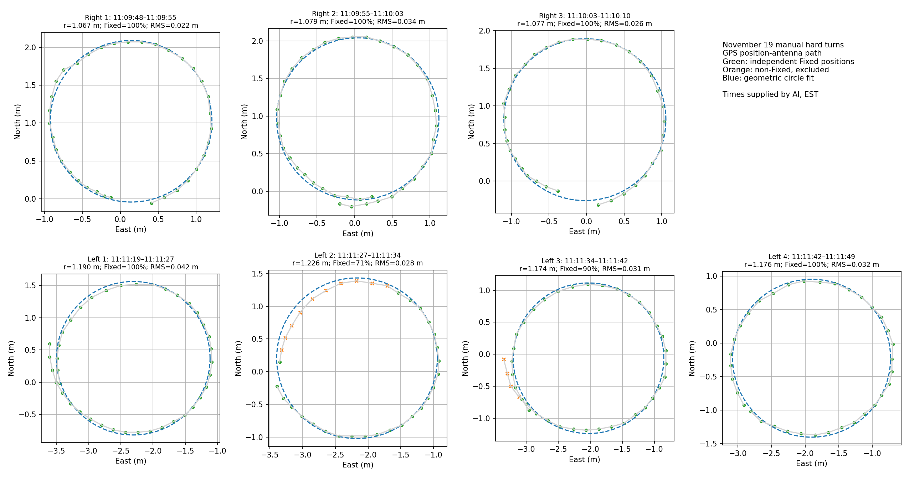
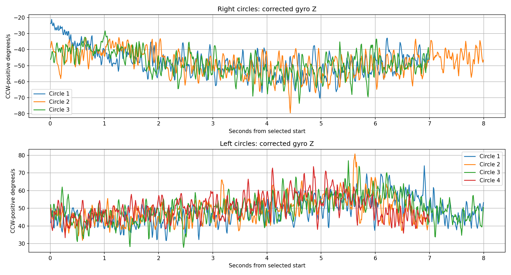

# November 19 selected hard-turn circles and IMU

Analysis dated November 20, 2026. Observed antenna-path radii, not a commissioned planning or swept-deck limit. All times EST on November 19.

| Direction / circle | Selected start–end | Fixed fixes | Radius | Diameter | Radial RMS | IMU mean turn rate, CCW + | IMU rotation |
|---|---|---:|---:|---:|---:|---:|---:|
| right 1 | 11:09:48–11:09:55 | 35/35 | 1.067 m | 2.134 m | 0.022 m | -47.95 deg/s | -335.7 deg |
| right 2 | 11:09:55–11:10:03 | 40/40 | 1.079 m | 2.157 m | 0.034 m | -48.12 deg/s | -384.9 deg |
| right 3 | 11:10:03–11:10:10 | 35/35 | 1.077 m | 2.154 m | 0.026 m | -48.51 deg/s | -339.5 deg |
| left 1 | 11:11:19–11:11:27 | 40/40 | 1.190 m | 2.381 m | 0.042 m | 48.26 deg/s | 386.1 deg |
| left 2 | 11:11:27–11:11:34 | 25/35 | 1.226 m | 2.453 m | 0.028 m | 48.99 deg/s | 342.9 deg |
| left 3 | 11:11:34–11:11:42 | 36/40 | 1.174 m | 2.349 m | 0.031 m | 49.84 deg/s | 398.8 deg |
| left 4 | 11:11:42–11:11:49 | 35/35 | 1.176 m | 2.353 m | 0.032 m | 50.41 deg/s | 352.9 deg |

## Additional IMU and motion observations

| Circle | Gyro Z p05–p95 (deg/s, CCW +) | Acceleration magnitude mean / std (g) | Reported GPS mean speed | Steering pot median | GPS speed / gyro radius |
|---|---:|---:|---:|---:|---:|
| right 1 | -60.38 to -31.25 | 1.095 / 0.193 | 0.886 m/s | 195 | 1.059 m |
| right 2 | -60.62 to -36.31 | 1.103 / 0.204 | 0.920 m/s | 195 | 1.096 m |
| right 3 | -61.54 to -36.67 | 1.096 / 0.190 | 0.913 m/s | 190 | 1.078 m |
| left 1 | 38.66 to 60.12 | 1.081 / 0.212 | 1.029 m/s | 880 | 1.222 m |
| left 2 | 38.67 to 61.76 | 1.082 / 0.227 | 1.065 m/s | 879 | 1.246 m |
| left 3 | 39.19 to 61.21 | 1.085 / 0.239 | 1.070 m/s | 884 | 1.230 m |
| left 4 | 40.25 to 62.14 | 1.084 / 0.203 | 1.070 m/s | 882 | 1.216 m |

Gyro X/Y standard deviations are approximately 5.6–6.7 and 3.7–4.5 deg/s respectively. Acceleration magnitude reaches approximately 1.8–2.25 g in individual samples, including gravity; these transient peaks are not sustained lateral acceleration. No IMU timing gap >50 ms or yaw-segment reset occurs in any selected interval. Reported rotations differ from 360 degrees because the selected whole-second boundaries are not exact revolution boundaries. Left circle 2 retains only about 235 degrees of sampled Fixed-position coverage and is less well constrained, even though its radial residual is small.





## Method and source

Raw November 19 archive and all three closed segment hashes/counts are verified before analysis. Source session is 7295481ca757417ead5487b37862ce3e. Independent position host-decode times are reconstructed from IMU monotonic time minus position decode age, grouped within 1 microsecond; repeated 20 Hz snapshots are not counted as independent positions. Exact user intervals are retained, with no automatic lap resegmentation or exclusion of inconvenient circles. A zero-duration interval produces no result.

Al corrected the first left interval to 11:11:19–11:11:27 and confirmed the second as 11:11:27–11:11:34 in this chat. These replace the zero-duration/overlapping entries in the initial screenshot.

Only RTK Fixed, nonfatal positions inside each interval enter the fit. Position eligibility is independent of heading quality. WGS84 local tangent east/north coordinates use the origin in results.json. An algebraic least-squares circle initializes iterative geometric radial least squares; every eligible point has equal weight and no smoothing or outlier deletion is applied. Radial RMS/p95/max, sampled angular coverage, centres and initial algebraic radius are recorded to expose noncircularity and limited arcs. The 0.10 m RMS and 300-degree coverage flags are descriptive review screens, not automatic calibration acceptance. Whole selected intervals can contain partial/multiple revolutions.

IMU uses native bias-corrected gyro Z and recorded continuous yaw. Positive yaw is CCW/left; negative is CW/right. Mean angular velocity is integrated yaw change over the exact selected duration, using interpolated boundary yaw. A >50 ms IMU gap or yaw-segment change invalidates integrated rotation. Native rate mean/median/std/min/max/p05/p95, raw gyro Z, other gyro axes and acceleration mean/noise/magnitude are retained in results.json. Acceleration includes gravity, mounting tilt and vibration; sensor X/Y are not automatically tractor lateral/longitudinal axes, so these are not direct lateral-acceleration or position measurements. Bias is not recalibrated during motion.

The time-weighted reported GNSS speed divided by absolute IMU angular speed is a consistency check in metres; it shares GNSS timing/quality limitations and is not independent ground truth. Mean calibrated wheel travel divided by integrated angle is another path-radius estimate, associated approximately with rear-wheel-centre travel rather than the antenna. Do not equate these reference points without measured lever arms. Steering pot distributions use recorded status receipt times and support checking whether feedback was near commissioned right191/left885.

## Per-circle flags

- right 1: No listed quality flag.
- right 2: No listed quality flag.
- right 3: No listed quality flag.
- left 1: No listed quality flag.
- left 2: Non-Fixed positions excluded; fit has incomplete source coverage; Limited sampled circle arc; radius less well constrained.
- left 3: Non-Fixed positions excluded; fit has incomplete source coverage.
- left 4: No listed quality flag.

Earlier November 17 settled antenna radii were left 1.172–1.197 m and right 1.049–1.057 m; see obsidian_vault/03-design/03-3-tractor/03-3-10-frame-chassis/20261117-observed-hard-turn-dimensions.md. Its map projection and lap selection differ, so comparisons are observational, not a controlled tire/steering-change experiment. Current fits do not replace planning clearances or measure the entire tractor/deck footprint. No production code, firmware, services or motion authority changed.

Rebuild:

```powershell
python field_testing/tools/analyze_selected_hard_turns_20261120.py --evidence-root field_testing/sites/62_Collins_multi_boundary_20260915/runs/20261119_manual --output-dir field_testing/sites/62_Collins_multi_boundary_20260915/analysis/20261120_selected_hard_turns
```
