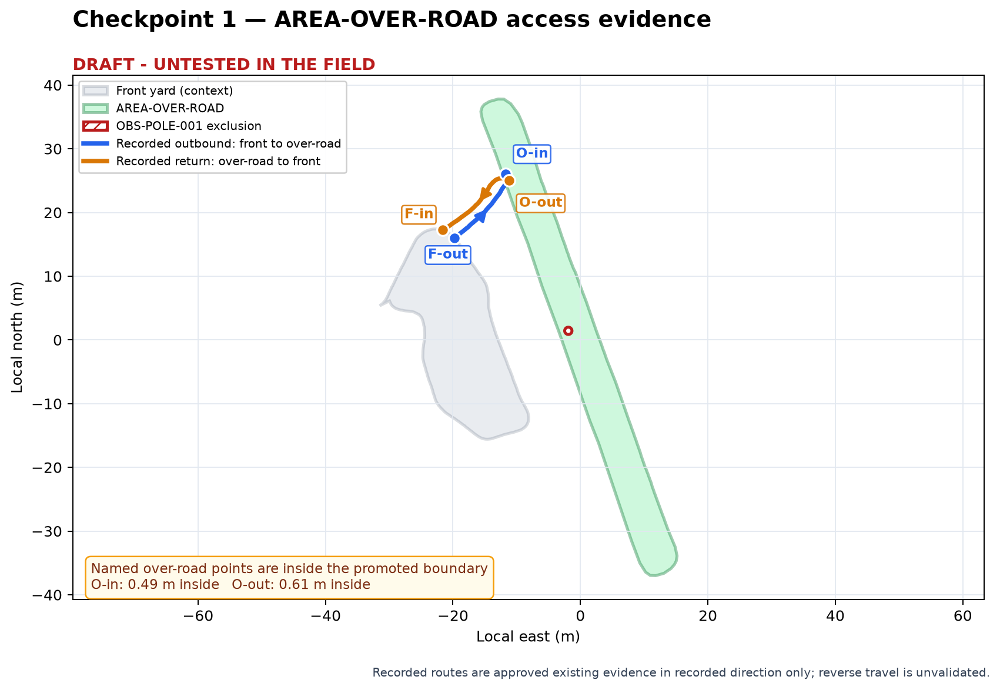

# Checkpoint 1 — access evidence and mission-purpose assumptions — revision 001

> **DRAFT - UNTESTED IN THE FIELD**

Date: 2026-10-23  
Scope: `AREA-OVER-ROAD` / `Over the road` only

This checkpoint creates no stripes, cells, turns, executable mission,
launcher, or field authorization.

## Verification result

The current pointers resolve to authoritative site inventory Revision 4 and
focused asset revision `rev_001_20261023_DRAFT_UNTESTED`.

| Check | Expected | Observed | Result |
|---|---|---|---|
| Authoritative inventory GeoJSON SHA-256 | `703a6b03845598cc4ef6596369fa13ebef43c28b2c7df176aa77d1de7571817b` | exact match | passed |
| Direct planning GeoJSON SHA-256 | `692514bc11c25340e1424f79d87e0e29b3da6aea44920a031d10115ba50a2a93` | exact match | passed |
| Focused package manifest | seven listed artifacts | every hash and byte count matched | passed |
| Direct planning polygon | one exterior ring and one pole hole | one exterior ring and one pole hole | passed |
| Retained source observations | 1,215 points, source rows 63,388–68,286 | exact match | passed |

The completed boundary, pole, turnaround, and inventory-promotion decisions
remain approved prerequisites. They are not being reconsidered here.

## Access evidence

| Recorded direction | Route | Length | Named area-side point | Evidence state |
|---|---|---:|---|---|
| Front yard to over-road | `ROUTE-FRONT-TO-OVERROAD` | 13.444 m | `ACCESS-OVERROAD-NORTH-OUTBOUND` (entry from front) | Route endpoints join their named points exactly; approved existing route in recorded direction only |
| Over-road to front yard | `ROUTE-OVERROAD-TO-FRONT` | 13.795 m | `ACCESS-OVERROAD-NORTH-INBOUND` (exit to front) | Route endpoints join their named points exactly; approved existing route in recorded direction only |

The two over-road access points are 1.138 m apart. Both remain inside the
promoted planning polygon, but not on its current outer edge:

- `ACCESS-OVERROAD-NORTH-OUTBOUND` is approximately 0.485 m inside;
- `ACCESS-OVERROAD-NORTH-INBOUND` is approximately 0.611 m inside.

That offset is consistent with the points and routes being carried forward
from the earlier inventory while the exact reviewed Revision 3 over-road shape
was promoted later. It does not invalidate the recorded connection, but it
means these should be treated as nominal ingress/egress anchors. This workflow
must not silently move them or claim they were re-field-validated.

## Historical values — evidence, not defaults

| Topic | Historical evidence | What remains to be chosen for this mission |
|---|---|---|
| Deck | 42 in / 1.0668 m | Confirm the cutting width to model |
| Lane spacing | 38 in / 0.9652 m gave about 4 in / 0.1016 m nominal overlap; an older archived coverage mission used 39 in / 0.9906 m | Select spacing or desired overlap |
| Coverage speed | Archived coverage mission used 0.75 m/s straight and 0.50 m/s headland/turn; perimeter and master test routes used 1.00 m/s | Select a conservative purpose-specific speed profile |
| Lookahead | Archived coverage mission used 3.0 m straight, 2.0 m headland, 1.5 m turn; perimeter/master routes generally used 2.0 m, with 1.5 m or 1.0 m near reviewed tight joins | Select values for the intended test and geometry |
| Turn radius | Manual evidence recorded about 1.05 m full-left and 1.63 m full-right; 1.90 m was used as the gentler planning target | Select a planning radius and state the evidence/margin |
| Headlands | Historical coverage work used two or three passes depending on the experiment | Select the strategy after accounting for the narrow shape and pole |
| Direction | Previous staged work preferred forward-only; the two access routes are validated only in their recorded directions | Confirm forward-only expectations and route direction |
| Blades and supervision | September/October moving tests were directly supervised and blades off | Confirm the intended state for the first physical test |
| Abort/recovery | Fail-closed Pause worked, but the October 21 phone-freshness qualification failed; neutral could not prevent rollback; Manual Recovery ground-motion sufficiency remains unproven | Define abort triggers, securing against rollback, and permitted recovery actions |

The October whole-site coverage artifacts are comparison evidence only. Their
parameters do not become this section's settings automatically.

## Exact decisions needed from Al

Please supply or revise every item below. A concise numbered reply is enough.

1. **Field-test purpose:** What should the first physical test establish—for
   example, access and tracking with blades off, full draft-route tracking with
   blades off, or actual cutting performance?
2. **Start/end and access:** Should the tractor start in the front yard, use
   the recorded outbound route to `ACCESS-OVERROAD-NORTH-OUTBOUND`, finish via
   `ACCESS-OVERROAD-NORTH-INBOUND`, and return to the front yard? Confirm or
   describe another start/end arrangement.
3. **Travel direction:** May each access route be used only in its recorded
   direction? State any other permitted travel explicitly.
4. **Deck width:** Confirm `1.0668 m` or provide the effective cutting width to
   model.
5. **Lane spacing/overlap:** Choose center spacing or intended overlap.
6. **Operating speed:** Choose straight, headland, turn, and access-route
   speeds, or one common speed.
7. **Pure-pursuit lookahead:** Choose straight, headland, turn, and access-route
   lookahead, or one common value.
8. **Turn radius:** Choose the planning value and whether `1.90 m` should be the
   initial review target; the 1.63 m weaker-right evidence has no planning
   margin.
9. **Headland strategy:** State the desired number/order of perimeter passes,
   or authorize later alternatives to compare two versus three passes.
10. **Forward-only and manual-only areas:** Confirm whether the autonomous
    draft must be forward-only and whether clearly reported manual-only pockets
    are acceptable.
11. **Blade state:** Confirm blades off or on for the intended first test.
12. **Supervision:** Define who must be present and how the physical e-stop,
    phone Pause, and spotting will be covered.
13. **Abort and recovery:** Define the triggers that end the test, whether any
    same-run guarded reacquisition is allowed, how rollback will be secured,
    and whether recovery must remain Manual/Pause only.

## Current uncertainties

- The access routes are strong recorded-direction evidence, but their named
  over-road points were inherited and sit slightly inside the promoted shape.
- The direct polygon is approved for planning, but the mission has not been
  field tested.
- Turn feasibility, uncovered ground, pole clearance, and manual-only pockets
  cannot be determined until the assumptions above are approved and
  Checkpoint 2 examines necessary decomposition.
- The latest field evidence does not support treating phone-control reliability
  or engine-running Manual Recovery as qualified.

## Checkpoint status

| Checkpoint | Artifact revision | Status | Blocking decision |
|---|---|---|---|
| Completed prerequisites — boundary, obstacle decisions, inventory promotion | focused asset revision `001` | approved | none |
| 1 — access evidence and mission-purpose assumptions | `checkpoint_1_access_and_operating_assumptions_rev001.md` | in review | Al must provide the 13 decisions and reply `approve`, `adjust`, `reject`, or `go back` |
| 2 — necessary decomposition | — | not started | Checkpoint 1 approval |
| 3 — strategy alternatives | — | not started | Checkpoint 2 approval |
| 4 — detailed draft and replay | — | not started | Checkpoint 3 selection |
| 5 — freeze design and create reusable skill | — | not started | Checkpoint 4 approval |
| 6 — supervised field-test package | — | not started | Checkpoint 5 approval |

Permitted next action: record Al's comments and explicit decision on this
revision. Do not begin Checkpoint 2 until Checkpoint 1 is approved.
