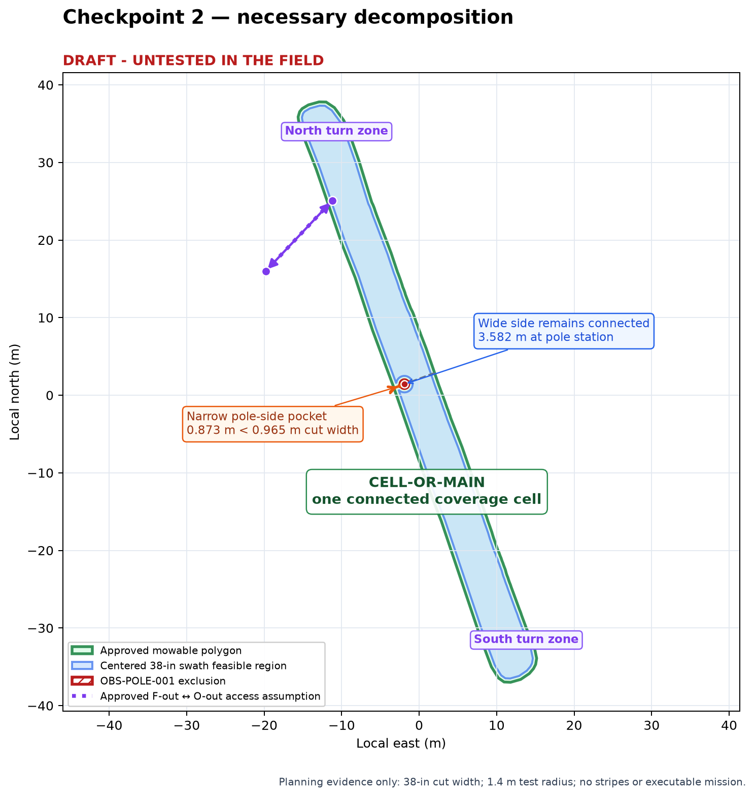

# Checkpoint 2 — necessary decomposition — revision 001

> **DRAFT - UNTESTED IN THE FIELD**

Date: 2026-10-23  
Scope: `AREA-OVER-ROAD` / `Over the road` only

This checkpoint proposes only the decomposition required by the approved
geometry and Checkpoint 1 assumptions. It creates no stripe alternatives,
waypoints, executable mission, launcher, or field authorization.

## Checkpoint 1 decision carried forward

Al approved Checkpoint 1 with these operating assumptions:

- create a draft mission that can later be tested;
- use the `F-out`↔`O-out` corridor as one path in both directions;
- retain the 42-inch physical deck, model a 38-inch cutting width and 38-inch
  lane spacing, and separately account for the approximately five-inch right
  discharge chute;
- use 1.0 m/s throughout;
- begin review with 2.0 m lookahead on straight/headland/access travel and
  1.5 m on turns, with results to be monitored;
- use 1.4 m as a test planning radius;
- make one outer-boundary pass, then use best-fit long-edge straight coverage;
- require forward-only autonomous motion;
- run the first feasibility test blades off under Al's close handheld
  supervision; and
- change neither Teensy firmware nor the pure-pursuit controller and retain
  the previous abort/recovery rules.

The `F-out`↔`O-out` bidirectional corridor is an owner-approved planning
assumption. The authoritative inventory still preserves the two older
recorded-direction routes as evidence; it has not been rewritten.

## Geometry findings

| Measure | Result | Planning meaning |
|---|---:|---|
| Net mowable area | 440.557 m² | Approved input area, including the pole hole |
| Best-fit long extent | approximately 78.95 m | Supports long-edge coverage as the strategy family to compare later |
| Maximum cross extent | approximately 6.90 m | The area is long and narrow |
| Best-fit long-axis heading | approximately 339.5° / 159.5° compass | Orientation evidence only; no stripe angle is selected here |
| Cross-section width at pole | approximately 5.598 m | Total outer width through the pole station |
| Wide corridor beside pole exclusion | approximately 3.582 m | Remains connected to the main area |
| Narrow corridor beside pole exclusion | approximately 0.873 m | Smaller than both the planned cutting width and physical deck |
| Planned cutting width | 0.9652 m (38 in) | Narrow corridor is about 0.092 m too small for one centered planned swath |
| Physical deck width | 1.0668 m (42 in) | Narrow corridor is about 0.194 m smaller than the deck, before chute clearance |

Shrinking the mowable polygon by half the planned 38-inch cutting width causes
the expanded pole exclusion to meet the outer boundary. The feasible centered
swath region remains one connected polygon, but the pole becomes a notch open
to the outside rather than an island that can be circled on both sides.

## Proposed minimum decomposition

### 1. `CELL-OR-MAIN` — one connected coverage cell

Keep the full feasible region as one main longitudinal cell. The pole does not
split the area into disconnected north and south cells because the wider side
remains connected. Creating separate north and south cells would add an
unnecessary connector and would not solve the narrow-side clearance problem.

### 2. `POCKET-OR-POLE-NARROW` — reported manual-only or intentionally uncovered pocket

Treat the approximately 0.873 m strip between the pole exclusion and the
nearby outer boundary as a review pocket, not an autonomous lane. A centered
38-inch cut cannot fit there, the 42-inch deck is wider still, and the right
chute can require additional directional clearance. No full autonomous loop
around the pole should be assumed.

This designation does not decide how the pocket will ultimately be handled.
It means later alternatives must report its area and either leave it uncut or
identify a separately approved manual method.

### 3. North and south turn zones — maneuver zones, not separate cells

Retain the tapered ends as turn-constrained zones inside `CELL-OR-MAIN`.
They do not need separate coverage-cell identities. With 0.9652 m lane spacing
and a 1.4 m test radius, an immediate adjacent-lane U-turn cannot be assumed:
twice the radius is 2.8 m, much larger than one lane spacing. Checkpoint 3 must
therefore compare forward-only ordering/turn concepts without silently
tightening the radius.

### 4. Outer boundary pass

Carry forward one clockwise outer pass as the initial perimeter concept. A
clockwise direction keeps the captured left deck edge on the outside cutting
boundary and the tractor/deck body toward the interior. The path centerline
and asymmetric right-chute envelope still require detailed validation later.

## Ground not presently promised autonomous coverage

- the narrow pole-side pocket described above;
- any tapered end sliver that cannot accept the 38-inch swath plus a contained
  forward-only transition at the 1.4 m test radius; and
- any area invalidated later by the physical right-chute envelope.

These are explicit uncertainties, not silent omissions. Their exact areas
will be measured for each Checkpoint 3 strategy alternative.

## Decisions needed from Al

1. Approve or adjust the proposal to use one main coverage cell rather than
   separate north and south cells.
2. Approve or adjust `POCKET-OR-POLE-NARROW` as a manual-only or intentionally
   uncovered review pocket unless later geometry proves a safe method.
3. Approve or adjust treating the pole as a notch approached only from the
   wide side, with no assumed full loop around it.
4. Approve or adjust the north and south ends as turn zones within the main
   cell rather than separate cells.
5. Approve or adjust one clockwise outer pass as the perimeter concept based
   on the left-deck-edge boundary capture.
6. Confirm that Checkpoint 3 may compare forward-only long-axis strategies
   while keeping the 1.4 m radius fixed as a test assumption and reporting all
   uncovered/manual-only ground.

## Checkpoint status

| Checkpoint | Artifact revision | Status | Blocking decision |
|---|---|---|---|
| Completed prerequisites — boundary, obstacle decisions, inventory promotion | focused asset revision `001` | approved | none |
| 1 — access evidence and mission-purpose assumptions | `checkpoint_1_access_and_operating_assumptions_rev001.md` | approved | none |
| 2 — necessary decomposition | `checkpoint_2_necessary_decomposition_rev001.md` | in review | Al must decide the six decomposition items and reply `approve`, `adjust`, `reject`, or `go back` |
| 3 — strategy alternatives | — | not started | Checkpoint 2 approval |
| 4 — detailed draft and replay | — | not started | Checkpoint 3 selection |
| 5 — freeze design and create reusable skill | — | not started | Checkpoint 4 approval |
| 6 — supervised field-test package | — | not started | Checkpoint 5 approval |

Permitted next action: record Al's comments and explicit decision on this
revision. Do not generate stripe alternatives before Checkpoint 2 approval.
