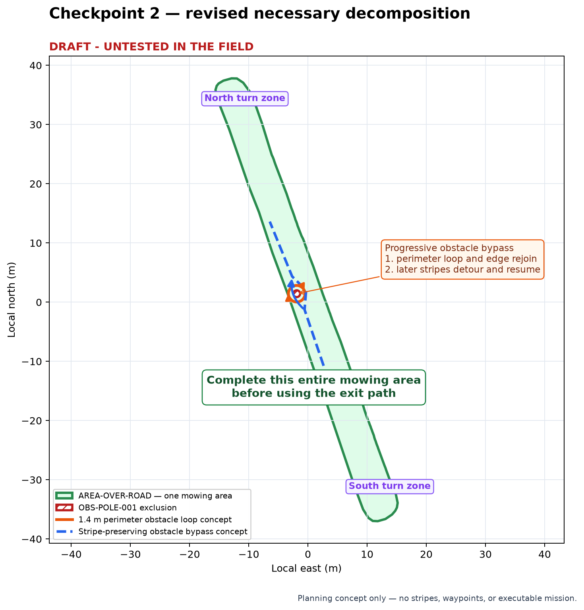

# Checkpoint 2 — necessary decomposition — revision 002

> **DRAFT - UNTESTED IN THE FIELD**

Date: 2026-10-23  
Scope: `AREA-OVER-ROAD` / `Over the road` only

Revision 002 replaces the proposed manual-only pole pocket in revision 001.
Revision 001 remains preserved as review history.

## Approved area model

Treat the polygon as one mowing area that must be cut in its entirety before
the tractor uses the exit path. No north/south coverage-cell split is needed.
The north and south ends remain maneuver zones within this one area.

## Reusable obstacle maneuver terminology

Use **progressive obstacle bypass** as the general maneuver family:

1. **Perimeter obstacle loop** — during the first clockwise perimeter cut,
   leave the outer edge, make a forward-only cut around the obstacle, and
   rejoin the same outer edge downstream.
2. **Stripe-preserving obstacle bypass** — when a later straight stripe would
   conflict with the obstacle, make the minimum smooth lateral offset needed
   for clearance, pass the obstacle with the required overlap, and return to
   the original stripe continuation instead of retracing the perimeter.

This names the behavior Al described without making the telephone pole or 62
Collins geometry part of the future generic skill. The skill should expose the
maneuver as an obstacle-handling policy and require each site project to supply
its obstacle geometry, radius evidence, cut width, physical envelope, and
approved clearances.

## Constraint retained for later validation

The minimum geometric gap between the current pole exclusion and the nearby
outer boundary is approximately 0.873 m. This no longer means the ground is
declared manual-only. It means the detailed design must validate the actual
centerline, deck/chute envelope, and overlap through the progressive bypass.

A conceptual 1.4 m-radius loop around the pole center remains inside the outer
polygon as a centerline, but reaches to approximately 0.044 m from the outer
boundary at its tightest point. That small centerline margin makes physical
deck/chute and terrain clearance a prominent detailed-design and field-test
item. It is not authorization to drive that loop.

## Approved decomposition decision

- one mowing area, completed before departure;
- no separate north/south coverage cells;
- north and south turn zones retained;
- one clockwise outer pass;
- progressive obstacle bypass required at the pole;
- no predeclared manual-only or intentionally uncovered pole pocket;
- forward-only motion and 1.4 m test radius retained for strategy comparison.

## Checkpoint status

| Checkpoint | Artifact revision | Status | Blocking decision |
|---|---|---|---|
| Completed prerequisites — boundary, obstacle decisions, inventory promotion | focused asset revision `001` | approved | none |
| 1 — access evidence and mission-purpose assumptions | `checkpoint_1_access_and_operating_assumptions_rev001.md` | approved | none |
| 2 — necessary decomposition | `checkpoint_2_necessary_decomposition_rev002.md` | approved | none |
| 3 — strategy alternatives | `checkpoint_3_strategy_alternatives_rev001.md` | in review | Al must select or adjust one strategy |
| 4 — detailed draft and replay | — | not started | Checkpoint 3 selection |
| 5 — freeze design and create reusable skill | — | not started | Checkpoint 4 approval |
| 6 — supervised field-test package | — | not started | Checkpoint 5 approval |
