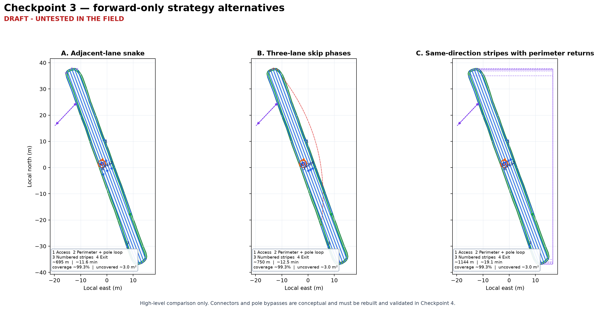

# Checkpoint 3 — strategy alternatives — revision 001

> **DRAFT - UNTESTED IN THE FIELD**

Date: 2026-10-23  
Scope: `AREA-OVER-ROAD` / `Over the road` only

These are high-level, non-executable alternatives. The connector arrows and
pole maneuvers are conceptual. No mission file or controller waypoints were
created.

## Common approved inputs

- complete the entire polygon before leaving;
- one clockwise outer pass;
- progressive obstacle bypass at `OBS-POLE-001`;
- forward-only motion;
- 38-inch planned cutting width and lane spacing;
- 42-inch physical deck plus approximately five-inch right chute;
- 1.4 m test planning radius;
- 1.0 m/s throughout;
- 2.0 m straight/headland/access lookahead and 1.5 m turn lookahead;
- first physical feasibility test blades off under direct handheld supervision;
- best-fit long-axis stripes for this area, approximately 339.5°/159.5°
  compass. The future skill must recalculate this orientation for each area.

## Comparison

| Alternative | High-level phases | Approx. route | Approx. motion time at 1 m/s | Modeled coverage | Uncovered | Turns/connectors | Minimum centerline clearance* | Main risk |
|---|---|---:|---:|---:|---:|---|---|---|
| A — Adjacent-lane snake | access → clockwise perimeter and pole loop → adjacent alternating stripes with local pole bypass → exit | 695 m | 11.6 min | 99.3% | 3.0 m² | 6 compact end turns; 1 affected-stripe bypass; perimeter pole loop | outer boundary 0.044 m; pole exclusion 0.829 m | Adjacent 0.965 m lane changes require compact omega/keyhole-like turns whose 1.4 m feasibility is unproven |
| B — Three-lane skip phases | access → perimeter and pole loop → every third stripe in phases → recover skipped stripes → exit | 750 m | 12.5 min | 99.3% | 3.0 m² | radius-friendlier skip turns; 2 phase relocations; affected-stripe bypass; pole loop | outer boundary 0.044 m; pole exclusion 0.829 m | Phase changes create long relocation connectors and may cross finished cuts or require perimeter travel |
| C — Same-direction stripes with perimeter returns | access → perimeter and pole loop → drive every stripe in the same direction, returning on the cut perimeter → exit | 1,144 m | 19.1 min | 99.3% | 3.0 m² | 6 perimeter returns; no immediate adjacent-lane U-turn; affected-stripe bypass; pole loop | outer boundary 0.044 m; pole exclusion 0.829 m | Longest route and repeated perimeter traffic may rut; every return must merge safely into the next stripe |

\* Clearances are centerline-only estimates for the conceptual 1.4 m pole
loop. The 0.044 m outer-boundary margin does not establish deck, chute, wheel,
or terrain clearance. That is a prominent Checkpoint 4 validation item.

The common buffered-swath calculation covers approximately 437.57 m² of the
440.56 m² approved polygon. The remaining approximately 2.99 m² is not being
accepted as manual-only ground. It is an estimate before detailed connector,
progressive-bypass, end-sliver, and asymmetric chute geometry is generated.
Checkpoint 4 must attempt to close and explain those gaps.

## Assessment

### A — Adjacent-lane snake

This is shortest and visually closest to ordinary mowing. It also asks the
most from the end turns. Because one lane spacing is much less than twice the
1.4 m radius, the end connectors cannot be treated as simple U-turns. They
would need compact forward-only omega/keyhole-like geometry and careful chute
validation.

### B — Three-lane skip phases

Three lane spacings equal approximately 2.896 m, slightly more than the 2.8 m
diameter of the test radius. That gives the cleanest radius margin for ordinary
end turns. The tradeoff is the phase change: after completing one set of every
third stripe, the tractor must relocate to recover skipped stripes. Those
relocations must not create diagonal cut marks or unsafe crossings.

### C — Same-direction stripes with perimeter returns

This avoids immediate U-turns by using the already cut perimeter as a return
lane. It is the simplest high-level forward-only turning concept but is about
65% longer than Alternative A and repeatedly loads the perimeter. It remains
useful as a conservative comparison or fallback for areas where contained end
turns cannot be made.

## Decisions needed from Al

1. Select `A`, `B`, or `C`, or request a hybrid/adjustment.
2. Confirm whether the proposed generic name **progressive obstacle bypass**
   matches the intended behavior. Its two sub-maneuvers are **perimeter
   obstacle loop** and **stripe-preserving obstacle bypass**.
3. Confirm that the selected strategy should attempt full modeled coverage in
   Checkpoint 4 rather than accepting the current approximate 3.0 m² gap.
4. Confirm that the 0.044 m conceptual centerline margin near the outer edge is
   a detailed-design warning requiring physical-envelope validation, not a
   reason to abandon the pole maneuver now.

## Checkpoint status

| Checkpoint | Artifact revision | Status | Blocking decision |
|---|---|---|---|
| Completed prerequisites — boundary, obstacle decisions, inventory promotion | focused asset revision `001` | approved | none |
| 1 — access evidence and mission-purpose assumptions | `checkpoint_1_access_and_operating_assumptions_rev001.md` | approved | none |
| 2 — necessary decomposition | `checkpoint_2_necessary_decomposition_rev002.md` | approved | none |
| 3 — strategy alternatives | `checkpoint_3_strategy_alternatives_rev001.md` | in review | Al must select or adjust one alternative and reply `approve`, `adjust`, `reject`, or `go back` |
| 4 — detailed draft and replay | — | not started | Checkpoint 3 selection |
| 5 — freeze design and create reusable skill | — | not started | Checkpoint 4 approval |
| 6 — supervised field-test package | — | not started | Checkpoint 5 approval |

Permitted next action: record Al's strategy selection and comments. Do not
generate a detailed route or executable mission before Checkpoint 3 approval.
