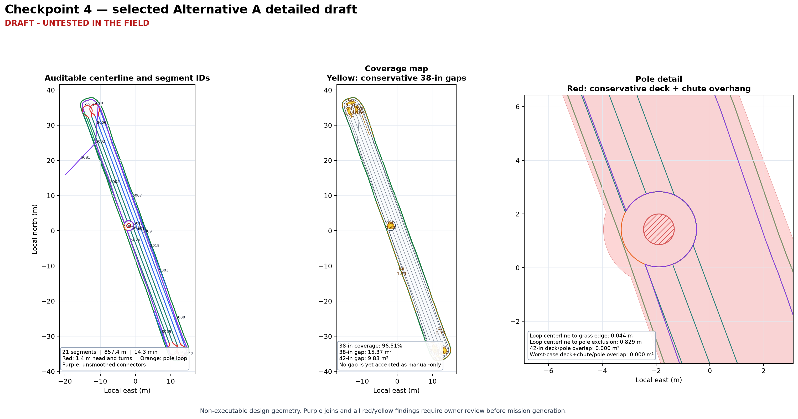

# Checkpoint 4 — detailed draft and replay — revision 001

> **DRAFT - UNTESTED IN THE FIELD**

Date: 2026-10-23  
Scope: `AREA-OVER-ROAD` / `Over the road` only  
Selected strategy: Alternative A, adjacent-lane snake with shortened stripes
and forward-only headland turns

This is auditable design geometry, not an executable mission. No Teensy,
pure-pursuit controller, launcher, or dashboard file was changed.

## Draft route produced

- enter on the owner-approved `F-out` to `O-out` corridor;
- make one clockwise outer pass;
- on that pass, leave the edge, make a complete 1.4 m-radius circle around
  the pole, continue on the wide-side arc, and rejoin the edge downstream;
- use seven 38-inch-spaced stripe centerlines at approximately 339.5°/159.5°
  compass heading;
- use a minimum-offset pole detour on three affected stripes;
- use four ordinary adjacent-lane forward-only headland turns at the 1.4 m
  planning radius;
- use the already-cut safe perimeter to relocate between the two short edge
  slivers and their neighboring full-length stripes; and
- return to `O-out` on already-cut ground, then use the same corridor back to
  `F-out`.

The two perimeter relocations are a detail that the high-level Checkpoint 3
model did not reveal. The first and seventh stripe intersections are short
edge slivers, not full parallel lanes. Forcing either to use an ordinary
adjacent U-turn produced a long path through the field; one trial also crossed
the pole exclusion. Revision 001 therefore routes those transitions on the
already-cut safe perimeter.

## Measured result

| Item | Revision 001 result |
|---|---:|
| Segments | 21 |
| Total route | 857.35 m |
| Motion time at 1.0 m/s | 14.29 min |
| Forward-only reversals | 0 |
| Ordinary adjacent headland turns | 4 |
| Edge-sliver perimeter relocations | 2 |
| Planning-radius result | all constructed turns measure approximately 1.4 m or greater |
| Centerline outside mapped outer boundary | 0.00 m |
| Minimum centerline clearance from pole exclusion | 0.828 m |
| 42-inch deck intersection with pole exclusion | 0.000 m² |
| Conservative deck-plus-chute intersection with pole exclusion | 0.000 m² |

The detailed route is about 162 m and 2.7 minutes longer than the Checkpoint 3
high-level estimate. Most of that difference is repeated travel on the cut
perimeter to reach the short edge slivers and exit safely. This means the
selected strategy is not yet demonstrated to be the fastest detailed design.

## Coverage map and gaps

The middle panel shows the remaining modeled grass in yellow. No yellow area
is classified as manual-only.

| Coverage model | Covered | Remaining gap |
|---|---:|---:|
| Conservative 38-inch planning swath | 96.51% | 15.37 m² |
| Actual 42-inch cutting deck width | 97.77% | 9.83 m² |

The 38-inch result is intentionally conservative: 38 inches is the lane
spacing, while the physical deck cuts 42 inches. The residuals are
concentrated at the irregular north and south ends, around the pole collar,
and along edge-sliver transitions. The largest conservative components are
approximately 2.67 m² and 2.50 m² at the south end, 1.73 m² at the north end,
and 1.62 m² around the pole.

Revision 001 does not silently add cleanup passes. A next revision can search
nearby stripe phases and headings, then add only the cleanup geometry still
needed after that optimization.

## Pole and outer-edge interpretation

The full pole circle deliberately includes the narrow side requested by Al.
Its tractor centerline remains inside the mapped grass boundary and comes
within approximately 0.044 m (1.7 in) of it. Its centerline remains about
0.829 m from the pole exclusion.

The 42-inch deck extends approximately 0.533 m from the centerline. At the
narrowest point, that means as much as approximately 0.489 m (19.3 in) of the
deck can extend past the mapped grass edge. A worst-case symmetric display
that also includes the approximately five-inch chute reaches farther. This is
the overhang Al said is acceptable for design exploration; it remains a
blades-off terrain and hazard verification item. The centerline itself does
not leave the boundary.

The pole detail also confirms that neither the 42-inch deck model nor the
conservative deck-plus-chute model enters the pole exclusion on this draft.

## Validation findings that prevent mission generation

- Segment endpoints are position-continuous to numerical tolerance, but 12
  joins change heading by more than 10°. These include access, perimeter,
  pole-loop, sliver-relocation, and exit joins. They must be replaced with
  smooth forward-only transitions.
- The pole-loop segment is intentionally non-simple because it makes one full
  circle and then repeats part of the wide-side arc to rejoin downstream.
- There are 43 nonadjacent centerline intersections. Most are expected recuts
  where turns and relocations cross the already-cut perimeter, but each must
  remain visible in replay and be checked after smoothing.
- The coverage gaps above remain open design findings.

For those reasons, revision 001 is **not suitable for Checkpoint 4 design
approval as an executable geometry basis**. It is suitable for deciding the
next adjustment.

## Audit artifacts

- `checkpoint_4_detailed_draft_rev001.geojson` — WGS84 segment geometry and
  lineage properties; explicitly marked non-executable;
- `checkpoint_4_segment_lineage_rev001.csv` — sequence, phase, source, length,
  and cumulative distance for every segment;
- `checkpoint_4_validation_rev001.json` — containment, clearance, spacing,
  coverage, curvature, connector, reversal, and intersection results;
- `checkpoint_4_interactive_replay_rev001.html` — dependency-free route replay;
- `checkpoint_4_detailed_overview_rev001.png` — static route, coverage, and
  pole-envelope review map.

## Decisions needed from Al

1. Confirm whether the two short edge slivers may use safe-perimeter
   relocations, or request a different stripe ordering.
2. Confirm whether revision 002 should optimize nearby stripe phase/heading
   and add cleanup passes with the goal of reducing the 9.83 m² physical-deck
   gap. This is recommended.
3. Confirm that the full 1.4 m pole circle and its displayed deck/chute
   overhang match the maneuver you intended.
4. Reply `approve`, `adjust`, `reject`, or `go back`. Because the joins are not
   yet smooth and gaps remain, `adjust` is the recommended response.

## Checkpoint status

| Checkpoint | Artifact revision | Status | Blocking decision |
|---|---|---|---|
| Completed prerequisites — boundary, obstacle decisions, inventory promotion | focused asset revision `001` | approved | none |
| 1 — access evidence and mission-purpose assumptions | `checkpoint_1_access_and_operating_assumptions_rev001.md` | approved | none |
| 2 — necessary decomposition | `checkpoint_2_necessary_decomposition_rev002.md` | approved | none |
| 3 — strategy alternatives and selection | `checkpoint_3_strategy_selection_rev002.md` | approved | none |
| 4 — detailed draft and replay | `checkpoint_4_detailed_draft_and_replay_rev001.md` | in review | Al's response to decisions 1–4 above |
| 5 — freeze design and create reusable skill | — | not started | Checkpoint 4 approval |
| 6 — supervised field-test package | — | not started | Checkpoint 5 approval |

