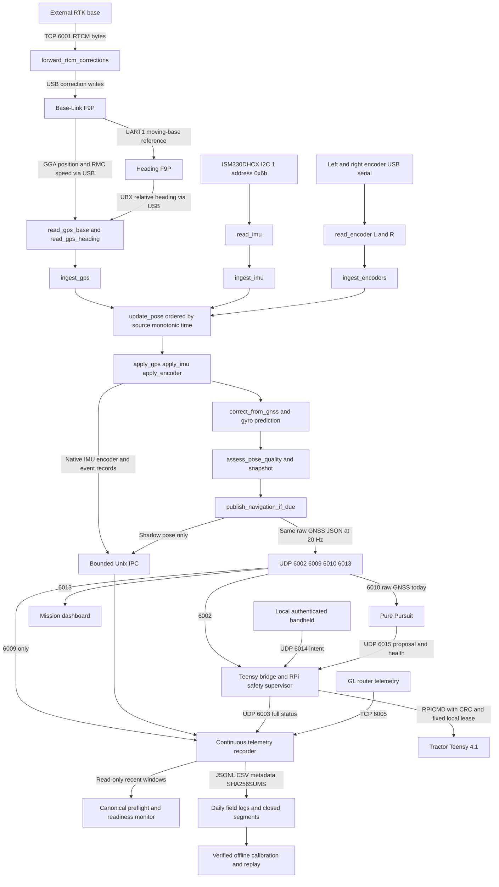
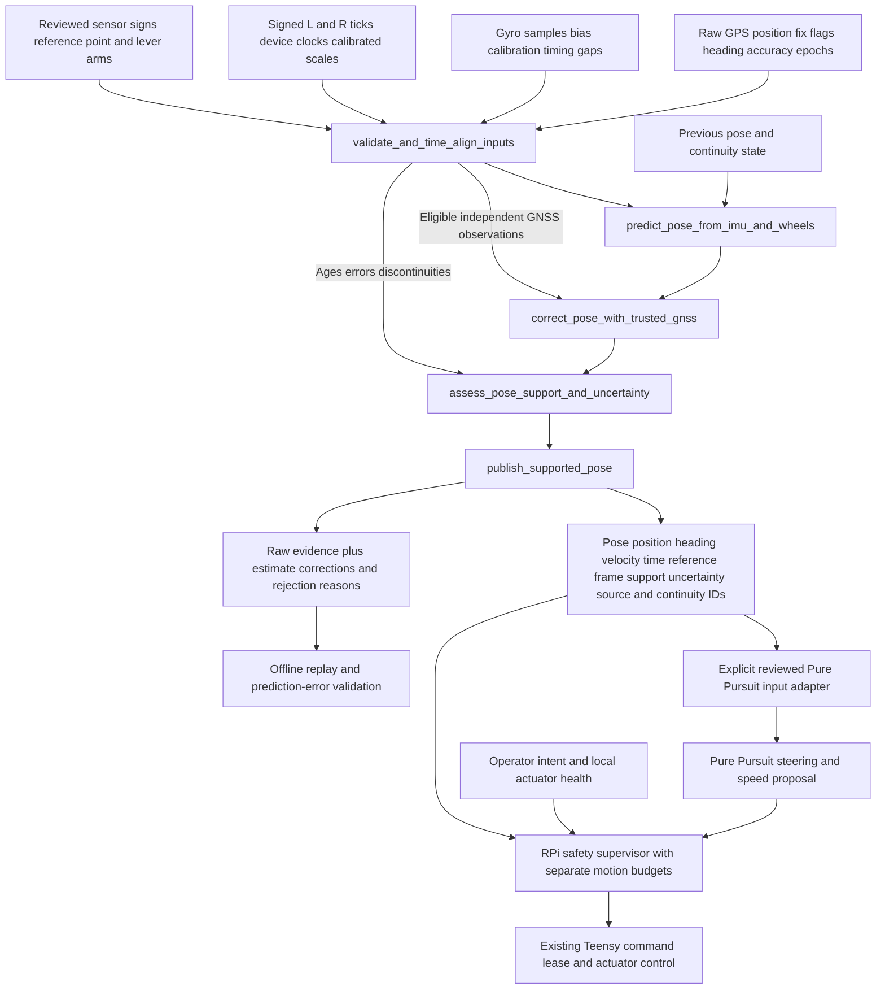

# GPS, IMU and wheel encoders: navigation-pose context

Prepared November 20, 2026, America/New_York.
**DESIGN / ANALYSIS HANDOFF — NOT VALIDATED FOR NAVIGATION CONTROL.**

This succeeds [the November 19 handoff](20261119-pose-integration-next-step-handoff.md).
Use [the companion continuation prompt](20261120-pose-fusion-continuation-prompt.md)
to start the next chat. First priority: measure encoder ticks against distance
travelled during trustworthy RTK Fixed windows, then use those findings to build
and evaluate a supported pose estimate offline.

## 1. Objective and meaning of “source of truth”

Al wants one navigation-pose producer to combine GPS, IMU and both wheel encoders.
Pure Pursuit should consume its best supported position and heading and calculate
the next steering proposal. Pure Pursuit should not independently decide which
sensor to believe or duplicate the estimator.

The eventual published pose is the **single agreed navigation input**, not a
claim of perfect physical ground truth. It must state its timestamp, reference
point, source/support mode and uncertainty or lack of support. Preserve raw GPS
and other sensor evidence separately so the estimate remains auditable.

Keep three responsibilities distinct:

1. **Estimate:** calculate position/heading from available sensor evidence.
2. **Track:** Pure Pursuit calculates a steering/speed proposal from the supported
   pose and reviewed route.
3. **Authorize:** the RPi safety supervisor selects the permitted command; the
   Teensy independently enforces its local lease, actuator checks and E-stop.

No new fused pose currently controls the tractor. The next work starts offline.

## 2. Workspace and source-of-truth rules

- Windows development: `C:\Repos\tractor2025`.
- Tractor01 runtime: `/home/al/tractor2025`, user `al`, hostname `raspberrypi`.
- RPi5NAS development: `/home/al/repos/tractor2025`.
- GitHub `main` is the software source of truth; Tractor01 pulls reviewed commits.
- Last verified three-way synchronization before this document: `cfbc949`.
  This is a historical checkpoint, not a claim about the next chat's current HEAD.
- Read repository-root `AGENTS.md` and
  `field_testing/TRACTOR01_CURRENT_FIELD_CONTEXT.md` before any field command.
- Raw evidence is ignored by Git. Do not delete, modify or normalize its bytes.
  Keep generated analysis outside `runs/`, with source/output SHA-256 provenance.
- Source changes, installation, firmware flashing, stationary checks, movement
  and blades are separate approvals. Do not infer motion permission from a replay.

## 3. Installed software and actual function boundaries

| Component | Source | Current responsibility |
|---|---|---|
| Sensor/position service | `tractor_rpi/calc_publish_position.py` | Owns F9Ps, IMU and encoder readers; receives/forwards external corrections; processes queued observations; publishes raw GNSS and records shadow pose |
| GNSS decoder | `tractor_rpi/position_gnss_protocol.py` | Protocol framing helpers/state and UBX decoding; producer also uses `position_model.parse_base_nmea()` |
| IMU helpers | `tractor_rpi/imu_sensor.py` | ISM330DHCX reading/scaling, bias statistics and yaw integration helpers |
| Pose state | `tractor_rpi/position_model.py` | `apply_gps()`, `apply_imu()`, `apply_encoder()`, `correct_from_gnss()`, `gps_quality()`, `quality()`, `snapshot()` |
| Recording transport | `tractor_rpi/telemetry_ipc.py` | Bounded Unix IPC, producer sessions/sequences, ACK/deduplication and observation queries |
| Continuous recorder | `tractor_rpi/telemetry_recorder.py` | Boot capture, recent observation windows, segmentation, metadata and closed hashes |
| Canonical preflight | `tractor_rpi/tractor_preflight.py` | Reads recorder windows; checks services/network, GNSS, Pause, firmware, IMU and both encoder streams |
| Current controller | `tractor_rpi/pure-pursuit/pure_pursuit_controller_20261022.py` | Frozen route tracking implementation; currently consumes legacy GNSS |
| Controller adapter | `tractor_rpi/pure-pursuit/pure_pursuit_arbitrator_feed_20261031.py` | Proposal/health feed to safety selection; does not own the Teensy |
| Safety input/supervisor | `tractor_rpi/rpi_arbitrator_inputs_20261031.py`, `rpi_safety_supervisor_20261031.py` | Joins freshness/local-health/route/operator evidence and selects allowed output |
| Production bridge | `tractor_rpi/teensy_serial_bridge_rpi_arbitrator_20261104.py` | Sole tractor-Teensy serial owner and command-lease sender |

Producer background readers: `read_gps_base()`, `read_gps_heading()`, `read_imu()`,
`read_encoder('L')`, `read_encoder('R')`, `forward_rtcm_corrections()`.
`BootPositionApp.monitor_readiness()` separately queries recorder status and
engine-off confirmations; IPC publishing has a bounded worker.

The scheduled approximately 20 Hz loop calls, in order:

```text
ingest_gps()
ingest_imu()
ingest_encoders()
update_pose()                    # process native observations by monotonic time
assess_pose_quality(now)
publish_navigation_if_due(now)
queue_diagnostics_if_due(now)
```

Threaded acquisition does not mean sampling each sensor only once per loop.
Native observations are queued. Hardware read time, producer emission time,
recorder receipt time and GNSS measurement epoch are different clocks/concepts.

### Current data-flow diagram — solid arrows are implemented



The chart describes the intended physical Base-Link-to-Heading reference link;
receiver-side correction acceptance must not be inferred from forwarded byte count.

## 4. Service/transport contracts that must remain intact

Current names: `calc-publish-position.service`, `tractor-teensy-bridge.service`,
`tractor-phone-arbitrator.service`, `tractor-telemetry-recorder.service`,
`tractor-startup-preflight.service`. Old production names `rtcm-server.service`
and `tractor-rpi-arbitrator.service` are aliases, not extra processes. The truly
retired `teensy-bridge.service` remains masked.

Ports 6002/6009/6010/6013 deliberately publish the same raw GNSS JSON at about
20 Hz to separate unicast consumers. Shared unicast receiving would cause packet
contention, not reliable fan-out. The recorder captures one copy, on 6009.
Do not bind another private logger/preflight to 6009 or silently replace raw
lat/lon/heading with estimates. Raw heading itself updates at approximately 5 Hz.

The frozen November 4 launcher starts a private logger and old UDP-binding
preflight; do not launch it unchanged with the consolidated boot recorder.
The future supported-pose interface/adapter must be explicitly reviewed rather
than quietly repurposing its consumers or inventing a port without a plan.

## 5. Current sensors, calibration and estimator limitations

- Tractor Teensy 4.1 serial `16883790`, commissioned firmware
  `teensy_main_20261110_rpi_command_lease_v5`.
- Left encoder: confirmed Teensy 3.1/3.2, USB serial `5879620`.
- Right encoder: USB serial `F5CB3C7E51514A4E43202020FF142006`.
- Resolve USB serial identity; ttyACM numbers change without moving cables.
- Raw encoder format: `ENC,side,device_ms,position,total_rot,delta_ticks,speed,delta_m`.
  `position` is a 14-bit angle, 0–16383. A sensor-shaft revolution is 16,384 ticks.
  Confirm mechanical coupling before calling it a wheel revolution.
- Current provisional metres per sensor revolution: **1.59593**, not calibrated.
  Firmware-reported speed/distance and `computed_delta_m` are derived quantities;
  use raw `delta_ticks` to estimate scale independently.
- `computed_delta_m` is recorded even on a discontinuous increment. Its existence
  does not make it supported odometry. Check `contiguous`, events and source gaps.
- `load_scales()` accepts a reviewed calibration JSON with schema 1, evidence
  reference, both exact USB serials and positive `metres_per_sensor_revolution`.
  A SHA-256 calibration ID is generated. No such calibration is installed by
  default. A positive scale alone does not encode a wrong/reversed sign fix.
- IMU gyro calibration is engine-off/stationary: fresh actual Pause/neutral,
  healthy stationary Fixed position and both quiet valid encoders, 3 s stillness,
  1 s settling and 10 s sample calibration with noise checks. Raw data is recorded
  while waiting. Bias calibration is not periodic compass correction.
- Healthy position AND heading permit experimental shadow heading anchoring
  every 5 s; corrected gyro Z propagates between anchors. The replay also shows
  a **once-anchored** IMU comparison. Do not confuse these two experiments.
- Current `snapshot()` explicitly sets `valid_for_control=False` and uncertainty
  `quantified=False`. Optional wheel propagation is experimental and must be
  audited for timing/reference-point/quality behavior before reuse in control.
- Current clock freshness thresholds and model support flags are implementation
  facts, not validated performance guarantees. Held coordinates must not appear
  current merely because a new snapshot timestamp was published.

## 6. Preserved evidence and operator context

Site root (repository-relative):
`field_testing/sites/62_Collins_multi_boundary_20260915/`.

### November 19 — primary encoder-calibration dataset

Raw copy: `runs/20261119_manual/` under the site root. Archive:
`manual_run_20261119.tgz`, 40,090,094 bytes, SHA-256:
`eb531f2c0504785f5c034073360533cef2157912524818e82a5b1bb50c0d2d19`.
Archive and all inner closed-segment manifests were independently verified on
Windows; original Tractor01 evidence was retained.

Segments: `telemetry_154324_711636Z`, `telemetry_155824_744702Z`,
`telemetry_161324_745916Z`. Names contain UTC; daily directory is Eastern date.
Raw channels: `gnss`, `status`, `imu`, `encoders`, `pose`, `events`, `router` JSONL;
also compatible `field.csv`, `metadata.json`, `SHA256SUMS`.

JSONL wrapper includes recorder UTC/monotonic receipt time, `payload`, and optional
producer session/sequence/emission time. Native IMU/encoder payloads additionally
carry their source host UTC/monotonic acquisition time; encoders have device_ms.
Look for producer restarts even when the recorder session remains unchanged.

Operator markers (EST): 10:59 engine off/manual steering check; 11:01 engine
running after two start attempts; approximately 11:14 parked/off/Pause. CW and
CCW square-ish paths plus hard turns, with approximately ten-second stops as
markers. Do not assign exact maneuver times from those notes alone. November 19
drive percentages were not supplied; do not copy November 17 percentages.

Full canonical preflight passed at 10:57. Recorder error/loss counters were zero
at the supplied checks. For 11:01–11:14, recorded streams included 83,574 IMU rows,
7,800 left encoder rows and 7,773 right encoder rows. Largest observed source
gaps were approximately 0.01321/0.10345/0.10448 seconds respectively. This proves
recorded continuity for that window, not calibrated distance or pose accuracy.

Replay: `analysis/20261119_manual_sensor_replay/replay_20261119_manual.html`.
Builder: `field_testing/tools/build_tractor01_sensor_replay_20261119.py`.
Template: `field_testing/tools/tractor-sensor-replay-template.html`.
Offline UI checker: `field_testing/tools/check_sensor_replay_ui_20261119.cjs`.
The display's 100 ms bins are not the source for quantitative calibration; use
full-rate raw observations. Existing replay health percentages include preparation,
not solely the drive. A calibration-to-observation segment transition is not
automatically an actual missing-sample gap; verify raw dt/events.

### November 17 — supplementary IMU and maneuver evidence

Raw: `runs/20261117_imu_manual/imu_20261117T161449_639816Z`, standalone logger
format, 154,769 rows. Replays/analysis:
`analysis/20261117_imu_manual_replay/` and `analysis/20261117_imu_manual_analysis/`.
Engine on 11:22, parked/off 11:37; CW square about 84% drive, CCW 100%, backing before
the second square, then hard left/right. These details belong to November 17.
Use that evidence for IMU comparison; do not assume it contains November 19's
full native encoder streams. Its standalone CSV schema differs from new segments.

Earlier observed hard-turn notes:
`obsidian_vault/03-design/03-3-tractor/03-3-10-frame-chassis/20261117-observed-hard-turn-dimensions.md`.
Reported antenna-path radii are not whole-tractor/deck planning clearances.

## 7. FIRST ANALYSIS: ticks versus trustworthy RTK distance

Answer these concrete questions before installing any encoder calibration:

- How many signed ticks does each sensor produce per metre of travel?
- Is that scale consistent between long straight sections, forward/reverse and
  different speeds? What is repeatability on independent held-out sections?
- Does the left/right discrepancy persist after turns, timing and lever arms
  are accounted for? What can and cannot be explained as slip?

### A. Verify and select windows

Verify archive/segment SHA-256 before analysis; match record counts with metadata.
Build a chronological audit of producer sessions, device clocks, resets, errors,
warnings, discontinuities, GNSS outages and stationary intervals. Read actual
encoder firmware gap/re-baselining semantics before deciding what an error loses.

Select multiple long, straight, moving **RTK Fixed** windows, separated by pauses
or turns. Require fresh valid position, plausible source progression, no fatal
GNSS error, stable direction, and continuous fresh samples on both encoders.
Use heading quality and steering feedback to screen turns and validate direction.
If heading is suspect, do not use it to certify a straight/reference transformation
without independent support. Record every selection threshold and excluded interval.
Forward and reverse windows must be identified separately; GPS scalar speed is
unsigned. Operator command direction is supporting evidence, not proof of motion.

Do not fit one scale from the whole two-square path. Inner/outer wheels travel
different distances in turns, and the GPS antenna follows another reference path.
Do not sum tiny stationary GPS jumps as real travelled distance.

### B. Align time and recover independent reference observations

Use source host monotonic times within a producer/boot continuity segment; retain
device_ms as a continuity/rate check and fit clock mapping only if required.
Document sensor/USB decode delay rather than assuming wall clocks are perfect.

Raw GNSS is republished at 20 Hz, but native fixes/heading are slower. Do not
interpret repeated snapshots as independent measurements. `relposned_count`
identifies heading updates, NOT GGA position updates. RMC speed counter is also
not a guaranteed GGA position counter; general `timestamp` can change on heading.

For November 19, inspect `imu.payload.gnss_position_age_s` with that row's
`monotonic_s`: their difference can identify the producer's last position-decode
time. Group with a documented numerical tolerance, then associate coordinates
and fix quality; validate this reconstruction against `apply_gps()` semantics.
This reconstructs host decode updates, not precise receiver measurement epochs.
If evidence cannot establish independent position times, state that limitation
and use an appropriate robust window-distance method instead of inventing timing.
Identical coordinates can be legitimate successive fixes; coordinate deduplication
alone is insufficient. A future raw schema should preserve position-specific
receiver epoch/sequence and decode timestamp explicitly.

Align window boundaries to common times; explain treatment of encoder increments
straddling a GNSS endpoint. Prefer long windows to reduce boundary ambiguity.
Never fill across a restart or error as if ticks were observed during the gap.

### C. Calculate an auditable distance reference

Convert WGS84 fixes to a documented local ENU/metre frame. On genuinely straight
windows, compare endpoint displacement and a robust fitted-track/projection
distance; inspect lateral residuals and outliers. Raw point-to-point distance
sums can overestimate travel through noise. Report which method is used and its
uncertainty/sensitivity; do not silently smooth until a preferred scale appears.

Choose the tractor pose reference point explicitly, likely a point appropriate
for the controller's geometry, but do not assume it without inspecting the current
controller. Confirm encoder coupling/axle, track width, GPS antenna offset and
heading-to-body offset from documentation or operator measurements. For rotation,
the antenna displacement differs from axle/reference-point travel. If geometry
is unavailable, initially restrict scale fitting to low-curvature windows and
quantify the remaining limitation. Turn compensation comes after straight fitting.

### D. Fit scale and validate on separate windows

For wheel side i and constant-direction window j:

```text
N_ij = sum(valid signed delta_ticks over the aligned window)
D_j  = reference distance with direction established independently
metres_per_tick_i = D_j / N_ij
ticks_per_metre_i = N_ij / D_j
metres_per_sensor_revolution_i = 16384 * metres_per_tick_i
```

Keep raw sign conventions visible; a backwards-installed sensor must not be
hidden by taking absolute values everywhere. Positive calibration scales currently
require signs to be handled consistently outside that scalar file contract.
Do not accumulate `abs(delta_ticks)` as distance: stationary jitter would grow
into false travel. Use signed accumulation in constant-direction windows and
separate net displacement from total travelled path through reversals.

Fit multiple windows, inspect residuals and a free-intercept diagnostic, then
justify any final through-origin robust/weighted fit. State weighting, accepted
windows, sample counts and uncertainty. Split by whole sections/maneuvers for
held-out validation; neighbouring points are correlated and are not independent
training/test evidence. Compare each side and mean-wheel travel against RTK.
Estimate confidence from independent windows or block resampling, not thousands
of duplicated snapshots. Report insufficient evidence rather than forced precision.

### E. Required derived outputs

- `REPORT.md`: readable results, plots, fitted units, uncertainty and limitations.
- `encoder_rtk_windows.csv`: per-window UTC/monotonic boundaries, direction,
  source sessions, RTK/heading quality coverage, reference distance/method,
  signed L/R ticks, included/excluded counts, gap/error counts, provisional and
  fitted distance, residuals, train/held-out membership and selection reason.
- `encoder_scale_candidates.json`: proposed sign/scale values, USB IDs, reference
  geometry, calibration units, fit evidence and validation metrics; **review only**.
  Do not set `reviewed_calibration=true` merely because fitting completed.
- Plots: RTK distance versus ticks per side, per-window scale, distance residuals,
  cumulative aligned distance and stationary jitter. Preserve all underlying values.
- Machine-readable audit of discontinuities/exclusions and source/output hashes.
- Optional replay overlay showing raw GNSS, encoder prediction and residuals.
  Keep the current raw replay intact; write a new derived comparison package.

Suggested output location under the site root:
`analysis/20261120_encoder_rtk_calibration_review/`.
This handoff does not itself contain a newly computed calibration result.

## 8. Proposed pose-estimator functions and publication contract

Reuse the established acquisition/main-loop split. The following function names
are **proposed responsibilities**, not claims about already implemented code.
Choose simple prediction/correction or a filter only after the evidence supports
the sensor/error model; an EKF is not required merely by the word fusion.



Contract decisions to settle before controller connection:

| Topic | Required statement |
|---|---|
| Position | Local x/y in metres and/or WGS84 with exact frame origin and physical reference point |
| Heading | Units, compass-vs-ENU convention, wrap, body-axis offset and supported flag independent of position |
| Timing | Measurement/state time, publication time, source ages and monotonic continuity; a fresh envelope does not freshen old data |
| Motion | Signed longitudinal speed, direction support, observed travel versus signed displacement |
| Quality | Source modes, valid/support flags, correction eligibility, uncertainty or explicit unquantified state |
| Continuity | Boot/producer/session identity, sequence, discontinuities, resets and reacquisition corrections |
| Anchors | Trusted position/heading anchor times and travel since anchors; correction/rejection records |
| Failures | Unsupported/null or clearly flagged held values, never plausible-looking unqualified coordinates |
| Calibration | Per-device scale/sign/mounting IDs and evidence/hash provenance |

Evaluate pristine GNSS, position-only loss, heading-only loss, combined loss,
IMU loss, one-wheel loss, both-wheel loss, restarts, reverse and GNSS reacquisition.
Do not use acceleration double integration as an assumed distance substitute.
Do not reset gyro bias while moving. Consider correction residual checks and
how large reacquisition jumps affect steering before choosing smoothing behavior.

## 9. Validation sequence and motion-budget ownership

1. Verify evidence and complete the tick/RTK analysis above.
2. Review coordinate frame, geometry, signs, timestamps and calibration candidates.
3. Implement an offline prediction/correction evaluator with testable pure functions.
4. Mask healthy GNSS offline for 1/5/10/30 s horizons, stratify by straight/turn/reverse,
   and compare predictions against held-out healthy reference. Mark these as
   counterfactual evaluations, not reconstructions of actual outages.
5. Quantify along/cross-track and heading errors, maxima/quantiles and valid
   coverage. Derive prediction intervals from held-out residuals, stating temporal
   correlation and limited coverage; do not call an empirical interval a guarantee.
6. Review proposed live shadow changes and focused fault tests; validate without
   feeding the new pose into control.
7. Only then review a versioned Pure Pursuit adapter and separate supervised
   field-validation package. No automatic deployment from a calibration analysis.

Al's proposed degraded allowance: **at most 3 m OR 30 s, whichever is reached first,
at up to 0.3 m/s**. At 0.3 m/s, 3 m is 10 s; 30 s would be 9 m. Time and distance budgets
are separate limits, not interchangeable approximations. These limits are not
implemented/commissioned as a GNSS-degraded motion policy.

Producer reports evidence, source support, anchor ages and reliable accumulated
travel. The final RPi supervisor owns any approved continuation incident and
authorization budget. The first qualifying loss starts an incident; intermittent
recovery must not quietly reset its budget. Specify the stopped-Pause operator
acknowledgement/rearm and position-versus-heading incident semantics explicitly.
Missing distance/time/support evidence cannot grant continued motion. Preserve
500 ms phone/Pure-Pursuit/Teensy freshness and the existing local actuator stops.
Do not confuse this proposal with the existing phone-only 30 s/30 m Auto envelope.

## 10. Startup/network findings that the next chat must retain

No source changes for navigation should undo the corrected ownership/startup
structure or add an internet gate to local Manual control.

- Left encoder cold-boot silence remains unresolved. USB reauthorization restored
  output without reflashing; device-clock continuation argues against firmware
  loss. cdc_acm rebind did not help. No automatic recovery is installed.
- GNSS Float despite fresh corrections and many satellites was observed; restarts
  preceded recovery in different trials. Multipath/base/host causes remain
  unisolated. Forwarded RTCM bytes are not proof of receiver use.
- Pi power logger now stores sibling daily CSVs; notification retry source is in
  `tractor_rpi/setup/pilog/`. On November 19 installed source was verified to match
  `cfbc949`, and Al received the updated notice. Runtime documentation may still
  contain earlier pending-install labels; inspect live state before asserting it.
- Internet-loss test1: Pixel mobile data enabled, local control stopped, local
  laptop SSH at 192.168.8.20 remained possible; phone/bridge services stayed running.
  Commands ceased 13:29:55 EST. Wi-Fi disconnect/reconnect restored the handheld;
  a new session was accepted 13:50:10. Exact Android/router cause is unproven.
- Test2: Pixel mobile data OFF. Starlink power removed; Link Age briefly reached
  about 1500 ms, recovered to 100–150 ms; Al successfully used Manual steering.
  Actual watchdog/Pause behavior during the gap still needs log confirmation.
- These support warm-system local Manual capability, not uninterrupted transport.
  Cold boot with Starlink down and mobile data off was planned; **no result has
  been reported in this chat**. Do not describe offline boot as validated.
- Full preflight includes external-network/GNSS checks and may fail offline even
  when local Manual is usable. The Manual supervisor path does not require RTK,
  heading, IMU calibration or full preflight completion; local command/actuator
  safety checks still apply. Do not infer Auto availability from Manual success.
- GL network local address is DHCP-delivered 192.168.8.20/24 on eth0. Phone server
  waits for that address, not ntfy delivery; the inspected boot showed Ethernet
  ready about 56 s, phone running about 58 s, ntfy succeeding much later after DNS
  recovered. Persistent operator URL key survives reboot; phone sessions do not.

## 11. Readiness for the next conversation

Start with local preserved evidence and offline analysis. No live connection,
new recording, controller launch or firmware upload is required to begin.
Inspect actual current Git state; do not assume this file's baseline SHA is HEAD.
Use the companion prompt. Deliver tick/RTK findings in understandable units before
proposing production pose changes, and keep unmeasured geometry/accuracy explicit.
